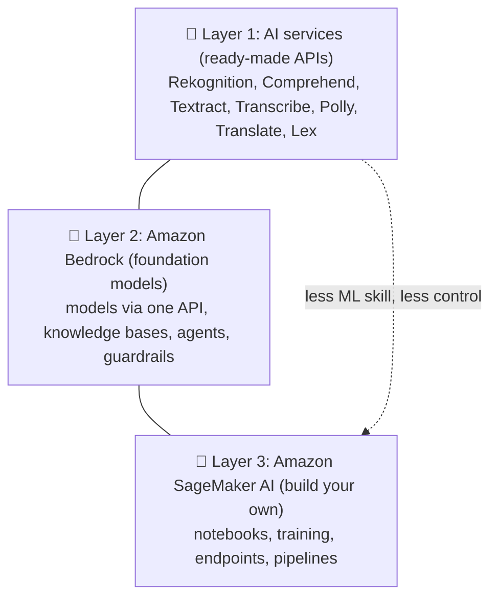
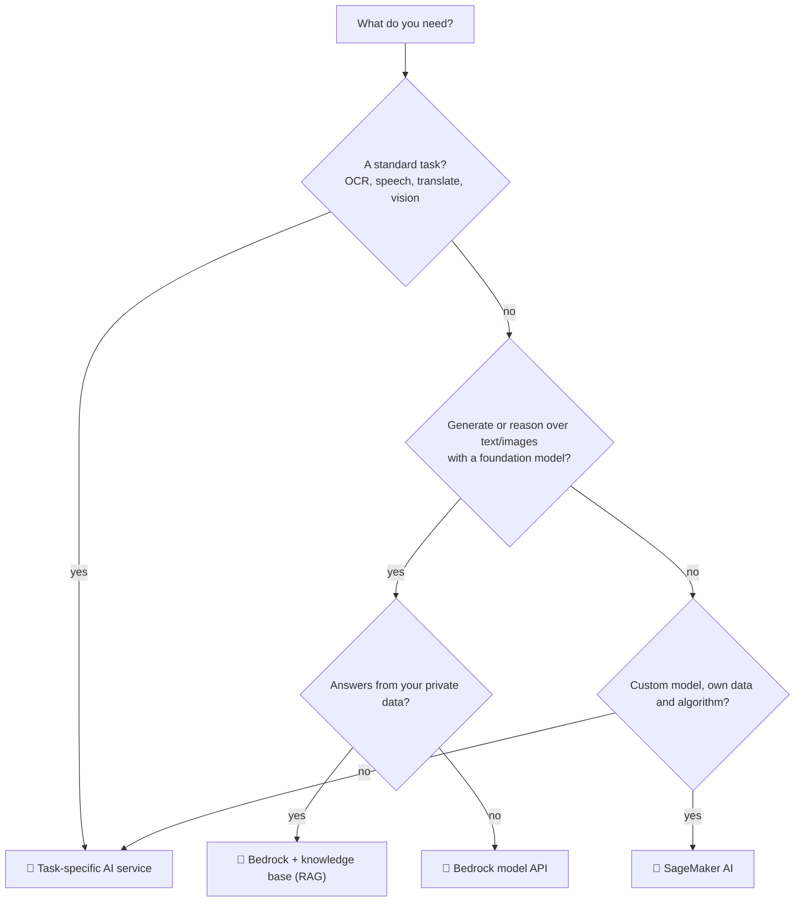
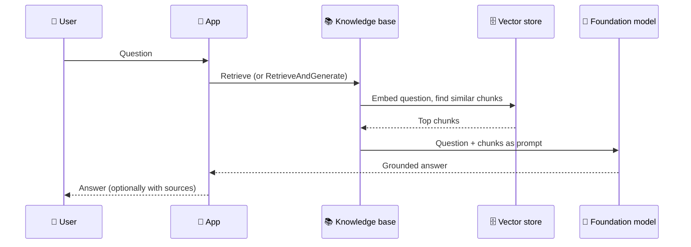

## What it is

AWS offers AI in **three layers**. Higher layers need less ML skill and give less control; lower layers give more control and need more work.

*Pick the highest layer that solves the problem.*

Use it when: you need to choose how to add AI to an application without over-building.

## Key concepts

**Layer 1: task-specific AI services.** You call an API; AWS owns the model. No training data needed for the basic features.

| Service | Job |
|---|---|
| Rekognition | Find objects, faces, text in images and video |
| Comprehend | Find insights in text (sentiment, entities) |
| Textract | Extract text, handwriting, tables from scanned documents |
| Transcribe | Speech to text |
| Polly | Text to speech |
| Translate | Neural machine translation |
| Lex | Chatbots with voice and text |

Kendra (intelligent enterprise search) also exists in this family; check current docs for its status and for which services are still open to new customers, because AWS changes availability over time.

**Layer 2: Amazon Bedrock.** A serverless service with a choice of foundation models (FMs, large pre-trained models) from several providers through one API. Around the models it adds:

- **Knowledge bases**: managed RAG over your own data.
- **Agents**: the model plans and runs tasks against your systems and data sources.
- **Guardrails**: safeguards on inputs and outputs, usable with model calls, agents, knowledge bases and flows.

**Layer 3: Amazon SageMaker AI.** A managed service to build, train and deploy ML models, including your own algorithms and foundation models. Naming note: on 3 Dec 2024 "Amazon SageMaker" was renamed "SageMaker AI", and the name "Amazon SageMaker" now means a wider unified platform for data, analytics and AI. API names, CLI commands and `AWS::SageMaker` CloudFormation types stayed the same. Check current docs, since branding keeps moving.

**Which service for which need?**

*Start at the top; only fall to SageMaker AI when the others do not fit.*

**RAG request flow.** RAG (Retrieval Augmented Generation) adds your own data to the prompt at question time, so the model needs no retraining. A knowledge base first splits your documents into chunks, turns them into embeddings (number vectors) and stores them in a vector store. At runtime:

*Retrieval finds relevant chunks; the model answers using them.*

The hands-on version is [Lab 16: RAG with Amazon Bedrock](/chapters/51-lab-16-build-rag-system-with-amazon-bedrock/).

## X vs Y

| | Task-specific AI services | Amazon Bedrock | SageMaker AI |
|---|---|---|---|
| You bring | Your input (image, audio, text) | Prompts and optionally your documents | Data, code or a chosen model |
| Model | Fixed, AWS-managed | Foundation models you choose | Your own or a hosted/public one |
| ML skill needed | Low | Low to medium | Medium to high |
| Infrastructure | None | Serverless | You pick instances and endpoints |
| Typical output | Labels, text, speech, translation | Generated text, chat, agent actions | Predictions from your model |

Pick **a task-specific AI service** when the task is standard (OCR, transcription, translation). Pick **Bedrock** when you want generative AI or RAG with little infrastructure. Pick **SageMaker AI** when you must train, tune or host a custom model and control the endpoint.

## Job notes

- Try a Layer 1 API first: one SDK call is cheaper to build than any model project.
- Bedrock model access, regions and quotas vary; check the current model list and quotas before designing.
- Add Guardrails when users type free text, for example to filter PII in answers.
- RAG needs a vector store, which can be a running cost; check the current pricing of the store you choose.
- SageMaker AI endpoints you leave running keep billing; delete them after experiments.
- Give the app an IAM role scoped to the specific service actions it calls, not `*`.

## Cheat sheet

- Three layers: AI services, Bedrock, SageMaker AI.
- Rekognition = images/video; Textract = documents; Comprehend = text insights; Transcribe = speech to text; Polly = text to speech; Translate = languages; Lex = chatbots.
- Bedrock = FMs via one API, serverless; knowledge bases (RAG), agents, guardrails.
- SageMaker AI (renamed Dec 2024) = build, train, deploy your own models.
- RAG = embed question, retrieve chunks, prompt the model with them.
- Choose the highest layer that works.

## AWS docs

- [What is Amazon SageMaker AI?](https://docs.aws.amazon.com/sagemaker/latest/dg/whatis.html)
- [How Amazon Bedrock knowledge bases work](https://docs.aws.amazon.com/bedrock/latest/userguide/kb-how-it-works.html)
- [Use cases for Amazon Bedrock Guardrails](https://docs.aws.amazon.com/bedrock/latest/userguide/guardrails-use.html)
- [Amazon Machine Learning documentation](https://docs.aws.amazon.com/machine-learning/)
