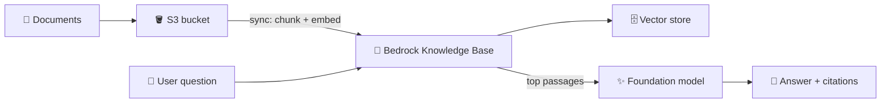
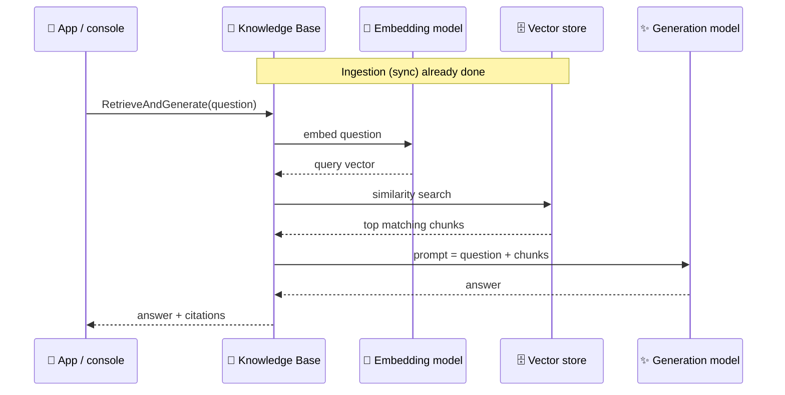

## What you build

A question-answering app over your own documents: files in S3 are split, embedded and stored in a vector store by a Bedrock Knowledge Base, and a foundation model answers using the retrieved passages. This pattern is called RAG (retrieval-augmented generation): look up facts first, then let the model write the answer. For the services behind it, see [AWS ML and AI services](/chapters/50-aws-ml-ai-services/).


*Left to right: documents go in once (ingestion); each question retrieves passages and the model answers from them.*

## Architecture


*Retrieve stops after the "top matching chunks" step; RetrieveAndGenerate continues to the model.*

- **Data source**: the S3 bucket (or prefix) with your files.
- **Chunking**: how files are cut into pieces. Fixed-size with overlap suits uniform documents like FAQs; semantic or hierarchical chunking suits long narrative or nested documents.
- **Embedding model**: turns each chunk and each question into a vector of numbers. The same model must be used for both.
- **Vector store**: holds the vectors and does similarity search. The console can create one for you ("quick create") or use one you made.
- **Generation model**: writes the final answer. You pick it by name in the console; see step 1.

| Vector store option | Note |
|---|---|
| Amazon OpenSearch Serverless | Common default. Can have a compute minimum that bills while idle; check current pricing |
| Amazon S3 Vectors | Documented as cost-effective, best for infrequent queries; not in every Region |
| Others (see the docs) | Bring-your-own stores need extra setup and permissions |

## Steps

The course lecture is one long demo; its exact documents, model and settings are not known to this chapter, so these steps are generic. Use any small set of text or PDF files you own.

1. **Choose models**: in the Bedrock console open the model catalog. Pick one embedding model and one text-generation model that are currently available in your Region. Do not copy model names from old tutorials; they change. The docs say serverless models are enabled by default, but Anthropic models may need a one-time use-case form.
2. **Create the bucket and upload documents**: S3 > Create bucket (Block Public Access on), then upload a few files.

```bash
aws s3 mb s3://my-rag-lab-<id> --region <region>
aws s3 cp ./docs/ s3://my-rag-lab-<id>/docs/ --recursive
```

3. **Create the knowledge base**: Bedrock > Knowledge bases > Create. Name it and let the console create a new service role.
4. **Add the data source**: type Amazon S3, point to the bucket or `docs/` prefix.
5. **Choose chunking**: start with the default or fixed-size; change it later if answers look cut off.
6. **Choose the embedding model** from step 1.
7. **Choose the vector store**: quick create is easiest. Before you click, read the cost note for the store you pick (see Cleanup) and use S3 Vectors if your Region supports it and you only need a lab.
8. **Create**, then open the data source and choose **Sync**. Wait until the status shows complete. Run Sync again after every change to the files.
9. **Test in the console**: in the knowledge base use "Test knowledge base". Turn "Generate responses" off to test Retrieve (raw passages, scores), on to test RetrieveAndGenerate (answer plus citations). Ask a question only your files can answer.
10. **Test from code**: boto3 uses the `bedrock-agent-runtime` client.

```python
import boto3
rt = boto3.client("bedrock-agent-runtime", region_name="<region>")

# Retrieve: passages only
r = rt.retrieve(
    knowledgeBaseId="<KB_ID>",
    retrievalQuery={"text": "What is our refund policy?"},
    retrievalConfiguration={"vectorSearchConfiguration": {"numberOfResults": 4}},
)
for hit in r["retrievalResults"]:
    print(hit["content"]["text"][:100])

# RetrieveAndGenerate: answer + citations
g = rt.retrieve_and_generate(
    input={"text": "What is our refund policy?"},
    retrieveAndGenerateConfiguration={
        "type": "KNOWLEDGE_BASE",
        "knowledgeBaseConfiguration": {
            "knowledgeBaseId": "<KB_ID>",
            "modelArn": "<ARN of a model or inference profile you can use>",
        },
    },
)
print(g["output"]["text"], g["sessionId"])
```

   Pass the returned `sessionId` back in the next call to continue the conversation.

11. **(Optional) Guardrails**: Bedrock > Guardrails > Create (for example deny a topic or mask PII), create a version, then attach it in the test panel or in the request. You can also call `ApplyGuardrail` on text yourself with the `bedrock-runtime` client.

Expected result: the answer quotes facts from your files, and the citations point to S3 object URIs.

## Common mistakes

| Mistake | Fix |
|---|---|
| Answers say "I don't know" after adding files | You forgot to sync again |
| `AccessDenied` on the model | Model not usable in this Region or account; pick another available model or finish the provider form |
| Model ARN rejected in RetrieveAndGenerate | Use a model or inference profile you can call in that Region |
| Answers cut off or off-topic | Try another chunking strategy or raise `numberOfResults` |
| Bucket and knowledge base in different Regions | Keep everything in one Region |
| Forgot the vector store after testing | It keeps billing; see Cleanup |

## Cleanup

Order matters, and the vector store is the cost risk. Some vector stores, such as OpenSearch Serverless, can bill for compute whenever the collection exists, even with no queries. The pricing page describes a minimum capacity for some collection types. Check current pricing for your store and Region.

1. Guardrails: delete any guardrail you created (optional step).
2. Agents: if you attached the knowledge base to an agent, remove it there first.
3. Knowledge base: Bedrock > Knowledge bases > Delete. The default data deletion policy removes the vectors it created, but the docs say the vector store itself is not deleted when you delete a knowledge base.
4. Vector store: delete it in its own console. For OpenSearch Serverless, delete the collection (OpenSearch Service > Serverless > Collections). For S3 Vectors, delete the vector index and vector bucket. If quick create made it, confirm in that service that it is gone.
5. S3: empty and delete the document bucket.

```bash
aws s3 rb s3://my-rag-lab-<id> --force
```

6. IAM: delete the service role the console created for the knowledge base, if you no longer need it.
7. Check: open the Billing console next day and look for OpenSearch Serverless or other vector-store lines.

If delete fails with "Unable to delete data from vector store", the store may already be gone or the role lacks permission; the AWS fix is to set the data source deletion policy to Retain and delete again.

## On the job

- Cost drivers: vector store (can dominate a small lab), embedding calls at sync, and generation tokens per question. Use a small file set while learning.
- Chunking and the choice of embedding model matter more for answer quality than the generation model.
- Always return citations to users, and restrict who can call the knowledge base with IAM.
- Use Guardrails to block topics and mask PII on both the question and the answer.
- Use Retrieve when you want your own prompt or a different model; use RetrieveAndGenerate for the quick path.

Related: [AWS ML and AI services](/chapters/50-aws-ml-ai-services/).

## AWS docs

- [Build a knowledge base with vector stores](https://docs.aws.amazon.com/bedrock/latest/userguide/knowledge-base-build.html)
- [RetrieveAndGenerate API](https://docs.aws.amazon.com/bedrock/latest/APIReference/API_agent-runtime_RetrieveAndGenerate.html)
- [Delete an Amazon Bedrock knowledge base](https://docs.aws.amazon.com/bedrock/latest/userguide/kb-delete.html)
- [Using S3 Vectors with Amazon Bedrock Knowledge Bases](https://docs.aws.amazon.com/AmazonS3/latest/userguide/s3-vectors-bedrock-kb.html)
- [Managing capacity limits for OpenSearch Serverless](https://docs.aws.amazon.com/opensearch-service/latest/developerguide/serverless-scaling.html)
