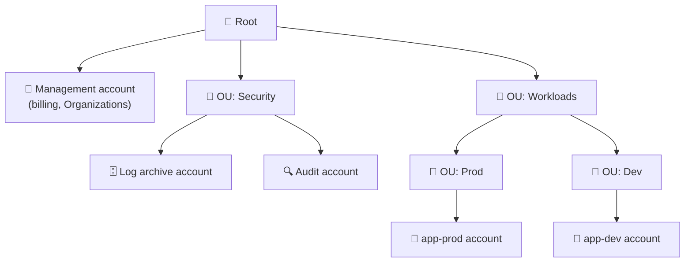
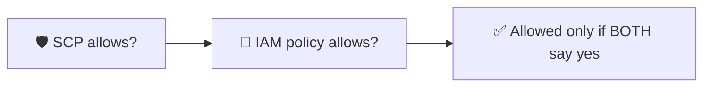
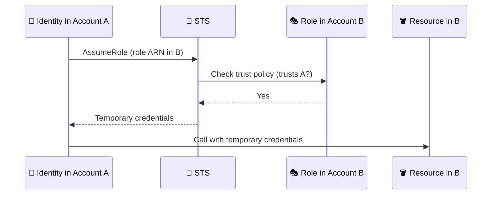

## What it is

A **multi-account strategy** means you run workloads in many AWS accounts instead of one big account. An account is the strongest isolation boundary AWS gives you, so a mistake or breach stays inside it. **AWS Organizations** groups the accounts, bills them together and lets you apply rules to them.


*An organization is a tree: root, organizational units (OUs), and accounts. SCPs attached to a node apply to everything below it.*

Use it when: more than one team, environment (dev/prod) or compliance scope shares AWS.

## Key concepts

**Why many accounts.**

| Reason | What it gives you |
|---|---|
| Blast radius | A compromised or broken account does not touch the others |
| Billing | Per-account cost, one combined bill |
| Isolation | Dev cannot accidentally change prod |
| Compliance | Put regulated data in its own account with stricter rules |

**AWS Organizations.**
- The **management account** creates the organization and pays all charges. Keep workloads out of it.
- **Member accounts** hold the workloads; **OUs** group them so you can apply policies once.
- **Consolidated billing**: one bill, combined usage for volume, Reserved Instance and Savings Plans discounts, no extra fee.
- Accounts can be created in the organization or invited in.

**Service control policies (SCPs).** Guardrails that set the maximum permissions for accounts.


*Effective permission is the overlap of the SCP and the identity's IAM policies; an SCP alone never grants.*

- Apply to member accounts, including their root user; they do **not** affect the management account.
- Inherited down the tree: a block at any parent level blocks the account.
- Typical uses: deny leaving the organization, deny disabling CloudTrail, allow only approved Regions.

```json
{
  "Version": "2012-10-17",
  "Statement": [{
    "Effect": "Deny",
    "Action": "organizations:LeaveOrganization",
    "Resource": "*"
  }]
}
```

**Control Tower and the landing zone.** A *landing zone* is a ready multi-account environment built on Organizations. Control Tower sets it up for you: recommended OUs, shared accounts such as log archive, controls (guardrails), and an Account Factory to create standard accounts.

**People access: IAM Identity Center.** Users sign in once to a portal and pick an account and role. You define **permission sets** (bundles of IAM policies) and assign them to users or groups per account. Identity Center creates a matching IAM role in each account for you.

**Cross-account roles.** For workloads or admins who need to reach another account, create a role there that trusts the source account. See [IAM](/chapters/04-aws-identity-and-access-management-iam/) for roles and trust policies.


*B's role trusts A; A's identity must also be allowed to call AssumeRole.*

## X vs Y

SCP vs IAM policy:

| | SCP | IAM policy |
|---|---|---|
| Attached to | Root, OU or account | User, group or role |
| Grants access | Never | Yes |
| Purpose | Maximum allowed (guardrail) | What this identity may do |
| Affects management account | No | Yes |

Organizations vs Control Tower vs Identity Center:

| | Organizations | Control Tower | IAM Identity Center |
|---|---|---|---|
| Job | Accounts, OUs, billing, SCPs | Set up and govern a landing zone | People sign-in to many accounts |
| Built on | Itself | Organizations plus other services | Organizations (multi-account permissions) |
| Effort | You design everything | Opinionated, fast start | Per-user and per-group assignments |

Pick **Organizations** as the base for any multi-account setup. Pick **Control Tower** when you want a best-practice baseline instead of building it yourself. Pick **Identity Center** to give people access across accounts without IAM users in each one.

## Job notes

- Separate prod from dev and put logs in a dedicated log archive account.
- Attach SCPs to OUs, not single accounts, so they are easy to manage and troubleshoot.
- Test an SCP on a sandbox OU first; a wrong deny can lock a whole OU out of an action.
- Secure the management account with MFA and keep it nearly empty; SCPs cannot restrict it.
- "Access denied" across accounts: check the SCP, the role's trust policy, and the caller's AssumeRole permission.
- Prefer roles and Identity Center over long-term IAM user keys.

## Cheat sheet

- Account = isolation boundary; use many to limit blast radius.
- Organizations: management account + OUs + member accounts; consolidated billing, no extra fee.
- SCP = maximum permissions, never grants; skips the management account.
- Effective access = SCP and IAM policy both allow.
- Control Tower = landing zone with controls and Account Factory.
- Identity Center = permission sets for people across accounts.
- Cross-account = role in target account + trust policy + AssumeRole.

## AWS docs

- [Service control policies (SCPs)](https://docs.aws.amazon.com/organizations/latest/userguide/orgs_manage_policies_scps.html)
- [Consolidating billing for AWS Organizations](https://docs.aws.amazon.com/awsaccountbilling/latest/aboutv2/consolidated-billing.html)
- [What Is AWS Control Tower?](https://docs.aws.amazon.com/controltower/latest/userguide/what-is-control-tower.html)
- [Manage AWS accounts with permission sets](https://docs.aws.amazon.com/singlesignon/latest/userguide/permissionsetsconcept.html)
- [IAM tutorial: Delegate access across AWS accounts using IAM roles](https://docs.aws.amazon.com/IAM/latest/UserGuide/tutorial_cross-account-with-roles.html)
