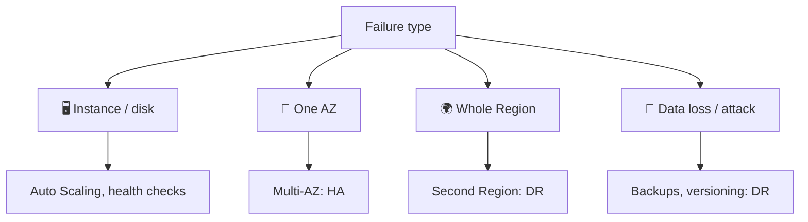
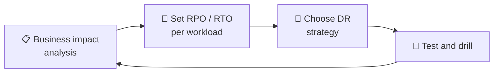
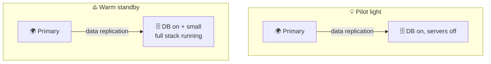
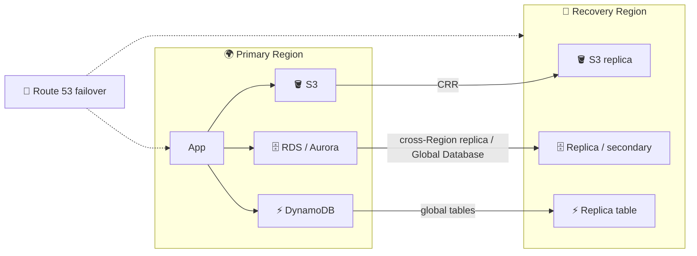
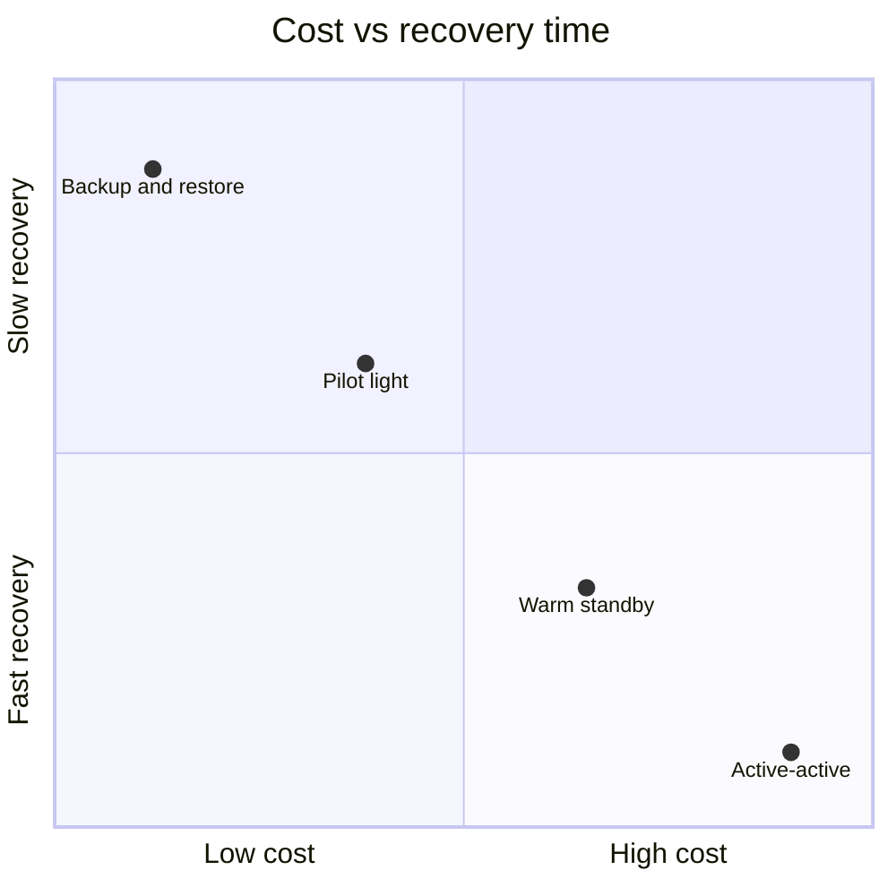
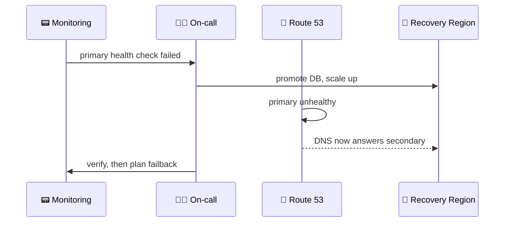

## What it is

**Disaster recovery (DR)** is the plan and setup to get a workload running again after a big failure, such as losing a whole Region, a bad deployment that destroys data, or ransomware. Two numbers drive every decision: **RPO** (how much data you can lose) and **RTO** (how long you can be down).

*RPO looks backward from the disaster; RTO looks forward to recovery.*

Use it when the business cannot accept losing the workload for good, and pick the cheapest design that still meets the agreed RPO and RTO.

## Key concepts

### Resilience, high availability and DR (Intro, Architecting for Resilience)

*High availability handles small, frequent failures; DR handles rare, large ones.*

| | High availability (HA) | Disaster recovery (DR) |
|---|---|---|
| Goal | Keep running through small failures | Recover after a major event |
| Scope | Usually several AZs, one Region | Usually another Region or site |
| Downtime | Near zero, automatic | Minutes to hours, often a decision plus a runbook |

- Resilience means the workload recovers from failures; design for failure, automate recovery, and test it.
- Multi-AZ is not DR for a Region outage. See [RDS Multi-AZ](/chapters/20-aws-database-services-amazon-rds/).

### Business Continuity Plan and the 6 scenarios (BCP)

A **Business Continuity Plan (BCP)** says how the business keeps its critical functions running during and after a disruption. DR is the IT part of it.

*Rank workloads by business impact first; the tech choice comes after.*

Typical scenarios the course walks through, and the strategy they usually point to (the course's exact six may differ):

| Scenario | RPO / RTO need | Likely strategy |
|---|---|---|
| Internal wiki, reports | hours / a day | Backup and restore |
| Back-office app | minutes / hours | Pilot light |
| Customer web shop | seconds-minutes / minutes | Warm standby |
| Payments, trading | near zero / near zero | Multi-site active-active |
| Ransomware or bad delete | point in time before the attack | Versioned, immutable backups |
| On-premises data center fire | depends on tier | Replicate servers into AWS |

- Different workloads get different tiers; do not pay for active-active everywhere.

### RPO vs RTO

| | RPO | RTO |
|---|---|---|
| Asks | How much data can we lose? | How long can we be down? |
| Measured | Time between last recovery point and disaster | Time from outage to restored service |
| Lowered by | Frequent backups, continuous replication | Pre-built infrastructure, automation, warm capacity |

- Example: nightly backup gives an RPO of up to 24 hours. Replication lag of seconds gives an RPO of seconds.
- Lower numbers always cost more.

### DR strategies on AWS

*Moving right: cost and complexity go up, RPO and RTO go down.*

*Pilot light has only the data layer on; warm standby has a whole small copy running.*

- **Backup and restore**: copy backups to another Region; after a disaster, rebuild infrastructure (with infrastructure as code) and restore data.
- **Pilot light**: data is replicated and always on in the recovery Region; app servers are created or started only on failover.
- **Warm standby**: a scaled-down but complete environment always runs; on failover you scale it up.
- **Multi-site active-active**: both Regions serve live traffic; failover means traffic shifts away from the failed side.
- Whatever the strategy, make sure failover works by testing it; an untested plan is a guess.

### AWS services that help

*Data layers replicate by themselves; Route 53 moves the users.*

| Service | Role in DR |
|---|---|
| **AWS Backup** | One policy-based place for scheduled backups and cross-Region (and cross-account) copies, for supported services. |
| **S3 Cross-Region Replication** | Automatic, asynchronous copy of new objects to a bucket in another Region. Existing objects need S3 Batch Replication. |
| **RDS cross-Region read replica** | Replica in another Region; promote it to a standalone database on disaster. Watch replication lag. |
| **Aurora Global Database** | Storage-level replication to secondary Regions; RPO typically seconds, RTO in minutes by promoting a secondary. |
| **DynamoDB global tables** | Multi-Region, multi-active replicas; any replica serves reads and writes, so shifting traffic gives low or zero RPO. |
| **Route 53 failover** | Health checks plus a failover (active-passive) policy return the secondary when the primary is unhealthy. |
| **AWS Elastic Disaster Recovery** | Continuous block-level replication of servers (on-premises or cloud) into a cheap staging area in AWS; launch instances for drills or recovery, then fail back. |

## X vs Y

### The four strategies

| | Backup & restore | Pilot light | Warm standby | Multi-site active-active |
|---|---|---|---|---|
| RPO | hours | minutes | seconds | near zero or none |
| RTO | up to about 24 hours | tens of minutes | minutes | near zero |
| What runs in recovery Region | nothing (backups only) | data layer only | small full stack | full stack, live |
| Cost | $ | $$ | $$$ | $$$$ |
| Complexity | low | medium | medium-high | highest |

*Illustrative positions only: the more you pay, the shorter the recovery.*

Pick **backup and restore** when hours of downtime and data loss are acceptable. Pick **pilot light** when you need recovery in under an hour but cannot pay for idle app servers. Pick **warm standby** when minutes of downtime are the limit and you want to be able to test on live capacity. Pick **multi-site active-active** when almost no downtime or data loss is allowed and you can afford, and operate, two live sites.

## Job notes

- Start by asking: what are the RPO and RTO per workload? Then choose a strategy, not the other way round.
- Back up outside the failure domain: copy to another Region and ideally another account.
- Use infrastructure as code so the recovery site is built the same way each time.
- Drill regularly; Elastic Disaster Recovery supports non-disruptive drills.
- Keep Route 53 failover TTLs low, since clients cache answers; see [Edge services](/chapters/48-aws-edge-services/).
- Cost traps: cross-Region data transfer, idle warm standby capacity, backup copies never expired.
- Replication copies mistakes too: a deleted or corrupted record is replicated. Keep point-in-time backups or versioning as well.

*A typical failover: detect, promote data, scale, shift DNS, verify.*

Hands-on labs follow: [setup](/chapters/54-lab-17-build-dr-site-on-aws-setup/), [backup and restore](/chapters/55-lab-17-build-dr-site-on-aws-backup-and-restore-str/), [pilot light](/chapters/56-lab-17-build-dr-site-on-aws-pilot-light/), [warm standby](/chapters/57-lab-17-build-dr-site-on-aws-warm-standby-strategy/), [multi-site active-active](/chapters/58-lab-17-build-dr-site-on-aws-multi-site-active-acti/).

## Cheat sheet

- RPO = data you can lose. RTO = time you can be down.
- HA = survives small failures (Multi-AZ). DR = survives a Region-sized loss.
- Order, cheap to costly: backup and restore, pilot light, warm standby, active-active.
- Pilot light: data on, servers off. Warm standby: small full copy running.
- AWS Backup: scheduled, cross-Region copies. S3 CRR: object replication.
- Aurora Global Database: seconds RPO, minutes RTO. DynamoDB global tables: multi-active.
- Route 53 failover: health check plus primary/secondary records.
- Elastic Disaster Recovery: continuous server replication, drills, failback.
- Test the plan; check current pricing for cross-Region transfer.

## AWS docs

- [REL13-BP02 Use defined recovery strategies](https://docs.aws.amazon.com/wellarchitected/latest/framework/rel_planning_for_recovery_disaster_recovery.html)
- [What is AWS Elastic Disaster Recovery?](https://docs.aws.amazon.com/drs/latest/userguide/what-is-drs.html)
- [Creating backup copies across AWS Regions](https://docs.aws.amazon.com/aws-backup/latest/devguide/cross-region-backup.html)
- [Aurora Global Database switchover and failover](https://docs.aws.amazon.com/AmazonRDS/latest/AuroraUserGuide/aurora-global-database-disaster-recovery.html)
- [Route 53 active-passive failover](https://docs.aws.amazon.com/Route53/latest/DeveloperGuide/dns-failover-types.html)
