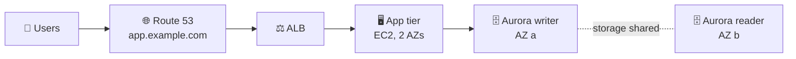
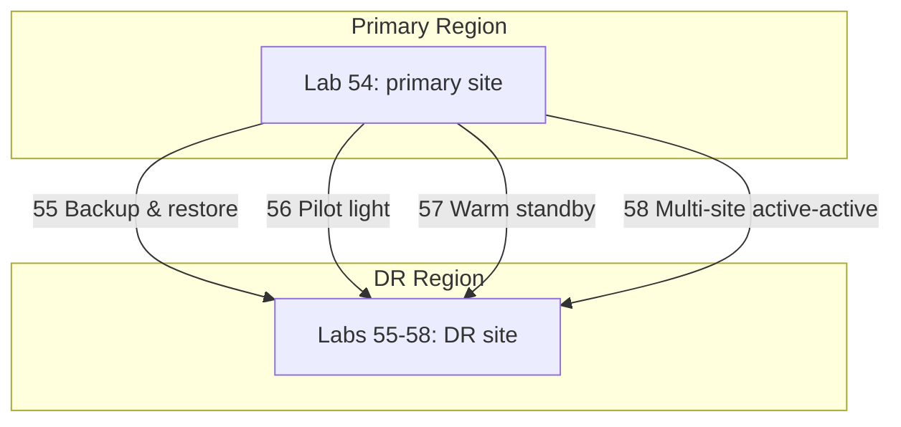
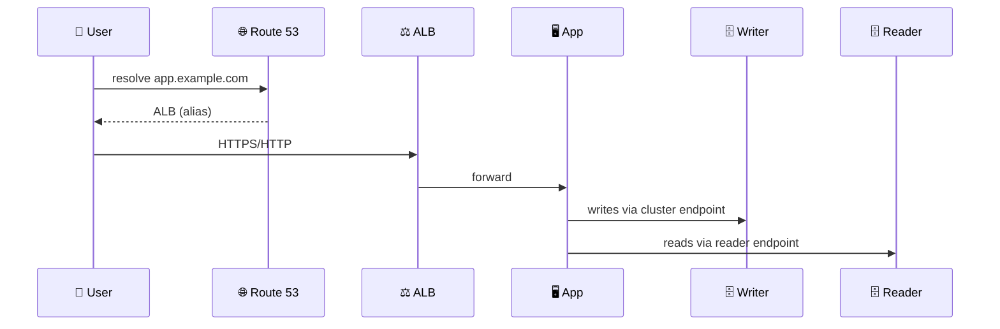
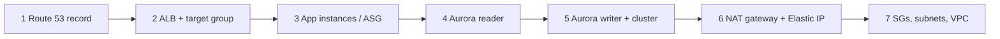

## What you build

The PRIMARY site that chapters 55 to 58 protect: an app tier behind a load balancer, an Aurora database with a reader replica, and a custom domain in Route 53. Concepts (RPO, RTO, strategies) are in [AWS Disaster Recovery](/chapters/53-aws-disaster-recovery/).



_Caption: the primary Region site. Everything here is one Region; the DR Region comes in the next labs._

Specifics of the course's sample app (language, repo, DB engine) are not in the lecture list, so the steps below stay generic. Follow the course repo for exact commands.

## Architecture



_Caption: one primary site is built once, then each lab copies it to a second Region with a different strategy._



_Caption: request path through the primary site._

- **App tier:** instances (or an Auto Scaling group) in private subnets across two AZs behind the ALB. Preferably built from a custom AMI or launch template, which later labs reuse in the DR Region.
- **Aurora cluster:** one writer plus up to 15 readers sharing one storage volume across AZs. Readers add no extra storage cost but each is a billed instance.
- **Endpoints:** the cluster endpoint always points to the current writer; the reader endpoint balances readers. Connect with these, not instance endpoints.
- **Route 53:** an alias record gives your own domain name to the ALB, so DNS can be switched later during a failover.
- **Naming:** use clear names or tags (`dr-lab`) so you can find and delete everything later.

## Steps

1. **Intro.** Pick a primary Region and decide a DR Region (a different geography, for example). Use a Region you can leave running for all five labs, and note both names.
2. **Build the primary site.** VPC with public and private subnets in 2 AZs; ALB in public subnets; app instances in private subnets with a security group that accepts traffic only from the ALB's security group.
3. **Create the database.** RDS > Create database > Aurora (engine as the course states), Multi-AZ subnet group, security group that allows the DB port only from the app's security group.
4. **Wire the app.** Put the cluster endpoint in the app's configuration (user data or config file) and launch the instances; register them in the ALB target group.
5. **Verify the primary site.** Browse to the ALB DNS name; confirm pages load and data is read and written. Check target health is `healthy` if not, read the instance's boot log.
6. **Add an Aurora replica.** RDS > Databases > select cluster > Actions > Add reader, in a different AZ than the writer.
   ```bash
   aws rds create-db-instance --db-cluster-identifier <cluster> \
     --db-instance-identifier <cluster>-reader --db-instance-class <class> --engine <aurora-engine>
   ```
7. **Fail over inside the Region.** Select the writer instance > Actions > Failover. Watch the reader become the writer, then reload the app; it should recover after a short interruption.
   ```bash
   aws rds failover-db-cluster --db-cluster-identifier <cluster>
   ```
8. **Custom domain.** Route 53 > Hosted zones > your zone > Create record: Simple routing, Alias, target the ALB, type A. Browse to the new name.

Expected result: the app answers on your own domain, and a manual failover keeps it working after a brief reconnect.

## Common mistakes

- **App uses an instance endpoint.** After failover it points to a reader. Use the cluster endpoint.
- **Reader in the same AZ as the writer.** An AZ outage then takes both. Use another AZ.
- **Database reachable from the internet.** Keep it private; allow only the app's security group.
- **No retry logic in the app.** Connections drop during failover; the app must reconnect.
- **Unhealthy targets.** Wrong health check path or the app security group not allowing the ALB.
- **Domain not resolving.** DNS can need time to propagate, or the record is in the wrong hosted zone.

## Cleanup

Do NOT delete this primary site yet: chapters 55 to 58 reuse it. Delete everything only after the last DR lab, and remove the DR Region resources from those labs first. The order for this lab's resources:



_Caption: DNS and load balancer first, database and network last._

1. Delete the alias record in Route 53 (keep the hosted zone only if you want it; it has a monthly fee).
2. Delete the ALB, then the target group.
3. Terminate app instances or delete the Auto Scaling group; delete custom AMIs and their snapshots if you made them.
4. Delete the Aurora reader, then the writer instance, then the cluster. Decline the final snapshot unless you want it.
5. Delete the NAT gateway if you made one, then release its Elastic IP.
6. Delete security groups, subnet groups and the VPC.

## On the job

- Multi-AZ readers protect against instance and AZ failures. Region failures need cross-Region designs, which the next labs show.
- Aurora instances bill per hour, so a lab left running costs money; check the current [Aurora pricing](https://aws.amazon.com/rds/aurora/pricing/) page.
- Lower DNS TTLs before a planned failover so clients switch faster (TTL values are your choice; check current docs).
- Next: [Backup & Restore strategy](/chapters/55-lab-17-build-dr-site-on-aws-backup-and-restore-str/).

## AWS docs

- [Adding Aurora Replicas to a DB cluster](https://docs.aws.amazon.com/AmazonRDS/latest/AuroraUserGuide/aurora-replicas-adding.html)
- [Aurora Replicas (prescriptive guidance)](https://docs.aws.amazon.com/prescriptive-guidance/latest/aurora-replication-options/aurora-replicas.html)
- [Aurora cluster endpoints](https://docs.aws.amazon.com/AmazonRDS/latest/AuroraUserGuide/Aurora.Endpoints.Cluster.html)
- [Alias record values in Route 53](https://docs.aws.amazon.com/Route53/latest/DeveloperGuide/resource-record-sets-values-alias.html)
