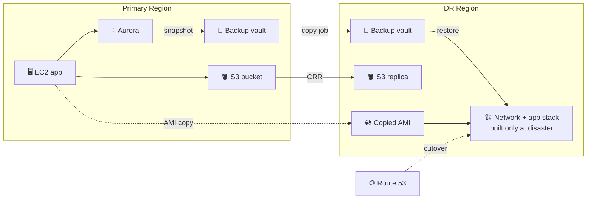
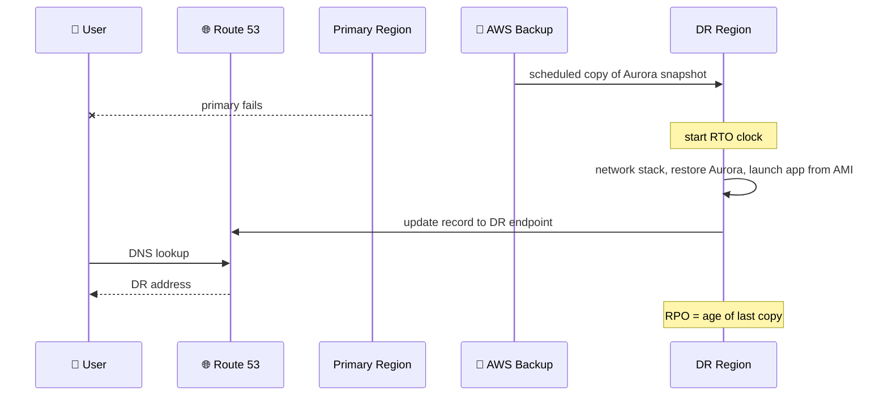

## What you build

A backup and restore DR plan for the 3-tier site from the previous lab: data is copied to a second Region ahead of time, and after a simulated primary failure you rebuild the site there and switch DNS.


*Data is protected in advance; compute is built only when needed. This is the cheapest and slowest DR strategy.*

Concepts are in [AWS Disaster Recovery](/chapters/53-aws-disaster-recovery/). The primary site and Route 53 custom domain come from [Setup](/chapters/54-lab-17-build-dr-site-on-aws-setup/). The next lab, [Pilot Light](/chapters/56-lab-17-build-dr-site-on-aws-pilot-light/), keeps the database always running in the DR Region to cut RTO.

## Architecture


*RPO is how old the last copy is; RTO is the time from failure until users are served again.*

- **AWS Backup**: central service with vaults (containers for recovery points), plans (schedule, retention, copy rule) and resource assignments (by tag or ID).
- **Cross-Region copy**: a copy job sends a recovery point to a vault in another Region. The first copy is full, later ones can be incremental where the service supports it, and the copy is re-encrypted with the destination vault's key.
- **S3 CRR**: Cross-Region Replication copies new objects to a bucket in another Region. It needs versioning on both buckets and an IAM role S3 can assume.
- **AMI copy**: an AMI exists in one Region only, so copy it to the DR Region to launch the app there. Copies do not carry tags or permissions over.
- **Network stack**: a CloudFormation template that creates the DR VPC, subnets and security groups, run only (or pre-built) in the DR Region.

## Steps

The lab's app specifics (names, templates, AMI IDs) are not in the docs I checked, so values below are placeholders. Replace `us-east-1` (primary) and `us-west-2` (DR) with your Regions.

**Stage 1: Understand AWS Backup (Intro, Detailed Guide)**

1. Read the AWS Backup concepts: vault, recovery point, plan, rule, assignment, copy job. Open AWS Backup > Dashboard in both Regions.

**Stage 2: Vaults and manual backup (vaults, on-demand, manual copy)**

2. In each Region: AWS Backup > Backup vaults > Create. Name them `prod-vault-primary` and `prod-vault-dr`. Use a KMS key you control or the default.
3. Primary Region: Create on-demand backup > resource type Aurora (cluster) > pick the cluster > vault `prod-vault-primary`. Wait for status Completed.
4. Open the recovery point > Actions > Copy > destination Region, vault `prod-vault-dr`. Check Copy jobs until Completed.

```bash
aws backup start-copy-job --region us-east-1 \
  --recovery-point-arn <arn> \
  --source-backup-vault-name prod-vault-primary \
  --destination-backup-vault-arn <dr-vault-arn> \
  --iam-role-arn <backup-role-arn>
```

**Stage 3: Automate (backup plan, assign resources, S3 CRR)**

5. Backup plans > Create > rule with schedule and retention, plus a copy rule: destination Region and vault `prod-vault-dr`. Pick the schedule from your RPO.
6. Assign resources: by tag (for example `backup=true`) or by resource ID, with the default Backup role. Tag the Aurora cluster and any EBS volumes.
7. S3: turn on versioning in the source and a DR bucket, then source bucket > Management > Replication rules > Create. Pick the DR bucket and let the console create the IAM role.
8. Copy the app AMI to the DR Region: EC2 > AMIs > Actions > Copy AMI.

**Stage 4: Disaster drill (DR network, verify, init)**

9. In the DR Region run the network CloudFormation stack (VPC, subnets, security groups). Verify in the VPC console that it exists in the DR Region, not the primary.
10. "Init": record the start time. Simulate the failure by treating the primary as lost (do not delete it yet; you compare later).

**Stage 5: Restore (Aurora, app stack, AMI)**

11. DR Region: AWS Backup > Vaults > `prod-vault-dr` > recovery point > Restore. Choose the DB subnet group and security group of the DR VPC.
12. Verify Aurora: status Available, a DB instance exists, and the data is present (connect with a client and run a count). Restore from the API creates only the cluster, so add an instance if none exists.
13. Run the app CloudFormation stack in the DR Region, pointing its launch template at the copied AMI and its DB setting at the new cluster endpoint (a restored cluster has new endpoints).
14. Test the app through the load balancer DNS name.

**Stage 6: Cutover and measure**

15. Route 53 > hosted zone > edit the app record to alias the DR load balancer. Wait for the TTL, then open the custom domain.
16. Stop the clock. RTO = cutover time minus failure time. RPO = failure time minus the recovery point's creation time.

```bash
aws route53 change-resource-record-sets --hosted-zone-id <id> --change-batch file://cutover.json
```

Expected result: the custom domain serves the site from the DR Region, with data as of the last copied backup.

## Common mistakes

| Mistake | Fix |
|---|---|
| Backups only in the primary Region | Add a copy rule to the plan or run a copy job |
| Restore button missing or fails on the cluster | Check the Backup role, and the DR vault key and subnet group |
| App cannot reach the restored DB | New cluster has new endpoints and needs a DB instance; update config and security group |
| S3 objects not replicating | Versioning must be on both buckets; the role needs a trust policy for S3; only new objects replicate |
| AMI missing in DR Region | AMIs are Regional; copy it and use the new AMI ID |
| DNS still points to primary | Lower the record TTL before the drill; remember cached answers |

## Cleanup

Delete in this order in BOTH Regions. Vaults with recovery points cannot be removed until the points are deleted.

1. Route 53: point the record back to the primary (or delete the lab record).
2. DR Region: delete the app stack, then the restored Aurora instance(s), then the restored cluster (skip or delete the final snapshot).
3. Delete the DR network stack (after the app stack is gone).
4. AWS Backup: delete the backup plan and its resource assignments, then delete recovery points in `prod-vault-dr` and `prod-vault-primary`, then the vaults.
5. S3: delete the replication rule, empty (all versions) and delete the DR bucket; empty the primary lab bucket if it was created for this lab.
6. EC2: deregister the copied AMI in the DR Region and delete its snapshots.
7. Check Cost Explorer next day for snapshot, cross-Region transfer and Aurora charges.

## On the job

- Backup and restore is the cheapest DR strategy, with the highest RTO and RPO (the Well-Architected guide lists RPO in hours and RTO up to 24 hours).
- Define RTO and RPO first; the plan schedule sets RPO, and your automation sets RTO.
- Use infrastructure as code for the DR stacks; rebuilding by hand is the biggest RTO cost.
- Practice the restore regularly; an untested backup is not a plan.
- You pay for backup storage and cross-Region data transfer; AWS Backup gives no SLA for copy job time.
- Copies keep the source's creation date and retention unless you override the retention.
- Route 53 failover records with health checks can automate cutover; the lab does it manually.

## AWS docs

- [Creating backup copies across AWS Regions](https://docs.aws.amazon.com/aws-backup/latest/devguide/cross-region-backup.html)
- [Backup and tag copy](https://docs.aws.amazon.com/aws-backup/latest/devguide/recov-point-create-a-copy.html)
- [Copy an Amazon EC2 AMI](https://docs.aws.amazon.com/AWSEC2/latest/UserGuide/CopyingAMIs.html)
- [REL13-BP02 Use defined recovery strategies](https://docs.aws.amazon.com/wellarchitected/2024-06-27/framework/rel_planning_for_recovery_disaster_recovery.html)
