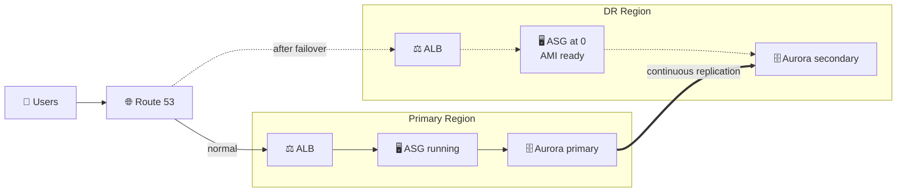
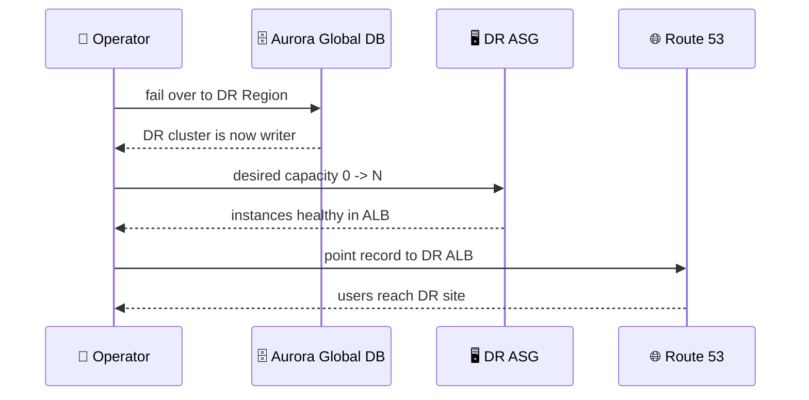

## What you build

A pilot light DR site: Aurora is replicated continuously into a second Region, while the web tier there is only prepared (AMI, launch template, ASG at 0). At failover you promote the database, scale compute up and switch DNS.

*Solid = running today. Dotted = switched off or unused until a disaster.*

## Architecture

*Failover order: data first, compute second, traffic last.*

- **Aurora Global Database:** one primary Region (the only writer) and secondary Regions fed by continuous replication. The lab uses it instead of a plain cross-Region read replica; an RDS cross-Region read replica works the same way but you promote it by hand and it cannot be undone.
- **EC2 Image Builder:** bakes the app AMI and, through distribution settings, copies it into the DR Region (an AMI is Region-bound).
- **DR app stack:** launch template, ASG (desired 0), ALB, instance role, S3 bucket access. Deployed from IaC so it matches the primary.
- **Route 53:** sends users to the primary ALB until you change the record. Failover routing with health checks is the automatic variant.
- **Not in the lecture titles:** the lab's exact app, stack names and bucket names are not documented here, so the steps stay generic.

## Steps

**Stage 1: Setup**

1. Pick the two Regions (primary and DR) and confirm the primary 3-tier app from the earlier labs is running.

**Stage 2: Aurora Global Database (lectures 2-4)**

2. RDS console, select the primary Aurora cluster, Actions, **Add AWS Region**, choose the DR Region and size the secondary. CLI equivalent starts with `aws rds create-global-cluster`.
3. Wait until both clusters are `Available` and check replication lag in the secondary.
4. Rehearse: run a **switchover** (planned, roles swap and replication reverses), then switch back. A real outage uses **failover** (managed failover is the recommended method for DR). Either way, applications must switch to the new writer endpoint.

**Stage 3: Golden AMI (lectures 5-6)**

5. EC2 Image Builder: create an image pipeline from the app recipe (install app, agents).
6. Create **Distribution settings** that add the DR Region, so the AMI is copied there after each build. Run the pipeline and confirm the AMI appears in the DR Region.

**Stage 4: DR app stack (lectures 7-10)**

7. In the DR Region, deploy the app stack (CloudFormation/IaC) using the DR AMI ID, with ASG desired capacity 0.
8. S3 bucket issue: bucket names are global and the app bucket is Region specific, so give the DR stack its own bucket or a Region-aware name, and replicate objects if the app needs them. The exact error in the lecture is not documented here.
9. Fix EC2 instance role: the role must allow what the app needs in the DR Region (S3 bucket, database secret). Attach the corrected instance profile to the launch template.
10. Verify: temporarily set desired capacity to 1, check the instance joins the ALB target group and the app loads through the DR ALB DNS name. Set it back to 0.

**Stage 5: Failover drill (lectures 11-12)**

11. Update Route 53: point the record to the DR ALB (alias) after the DB is writable and the ASG is scaled up.
12. Verify the global database: write a row through the DR site and check the cluster roles (DR = writer). Expected result: the app works from the DR Region.

**Stage 6: Clean up (lecture 13)** - see Cleanup.

## Common mistakes

- Scaling the ASG up before the database is writable: the app starts and then errors.
- AMI only in the primary Region, or launch template pointing to the primary AMI ID.
- Instance role or bucket exists only in the primary Region (the two lecture fixes).
- Forgetting to update app config to the new DB writer endpoint after switchover.
- Treating replication as a backup: corruption replicates too. Keep backups or point-in-time recovery as well.
- Leaving the secondary Aurora cluster running after the lab; it is the main cost.

## Cleanup

Delete in this order. Exact console clicks for Aurora are not verified here; check the Aurora docs link.

1. Restore Route 53 to the original record (or delete the lab record).
2. DR Region: set ASG desired capacity to 0, then delete the DR app stack (ASG, launch template, ALB, target group).
3. Delete the DR S3 bucket (empty it first) and any extra instance role.
4. EC2 Image Builder: delete the pipeline, recipe, distribution settings; deregister the AMIs in both Regions and delete their snapshots.
5. Aurora: remove the DR secondary cluster from the global database, delete its DB instances, then the DR cluster.
6. Delete the global database, then the primary cluster instances and cluster (skip or keep a final snapshot as you prefer; delete it later to stop storage charges).

## On the job

- Pilot light usually gives RPO and RTO in the tens of minutes; warm standby is faster and costs more. See [DR concepts](/chapters/53-aws-disaster-recovery/).
- Put the failover steps in a runbook and test them on a schedule. Untested DR is a guess.
- Deploy infrastructure and app changes to both Regions from one pipeline so DR does not drift.
- Compare with the cheaper [Backup & Restore lab](/chapters/55-lab-17-build-dr-site-on-aws-backup-and-restore-str/) and the faster [Warm Standby lab](/chapters/57-lab-17-build-dr-site-on-aws-warm-standby-strategy/).

## AWS docs

- [Disaster recovery options in the cloud (pilot light)](https://docs.aws.amazon.com/whitepapers/latest/disaster-recovery-workloads-on-aws/disaster-recovery-options-in-the-cloud.html)
- [Aurora Global Database: switchover and failover](https://docs.aws.amazon.com/AmazonRDS/latest/AuroraUserGuide/aurora-global-database-disaster-recovery.html)
- [Adding an AWS Region to an Aurora global database](https://docs.aws.amazon.com/AmazonRDS/latest/AuroraUserGuide/aurora-global-database-attaching.html)
- [Image Builder distribution settings](https://docs.aws.amazon.com/imagebuilder/latest/userguide/manage-distribution-settings.html)
