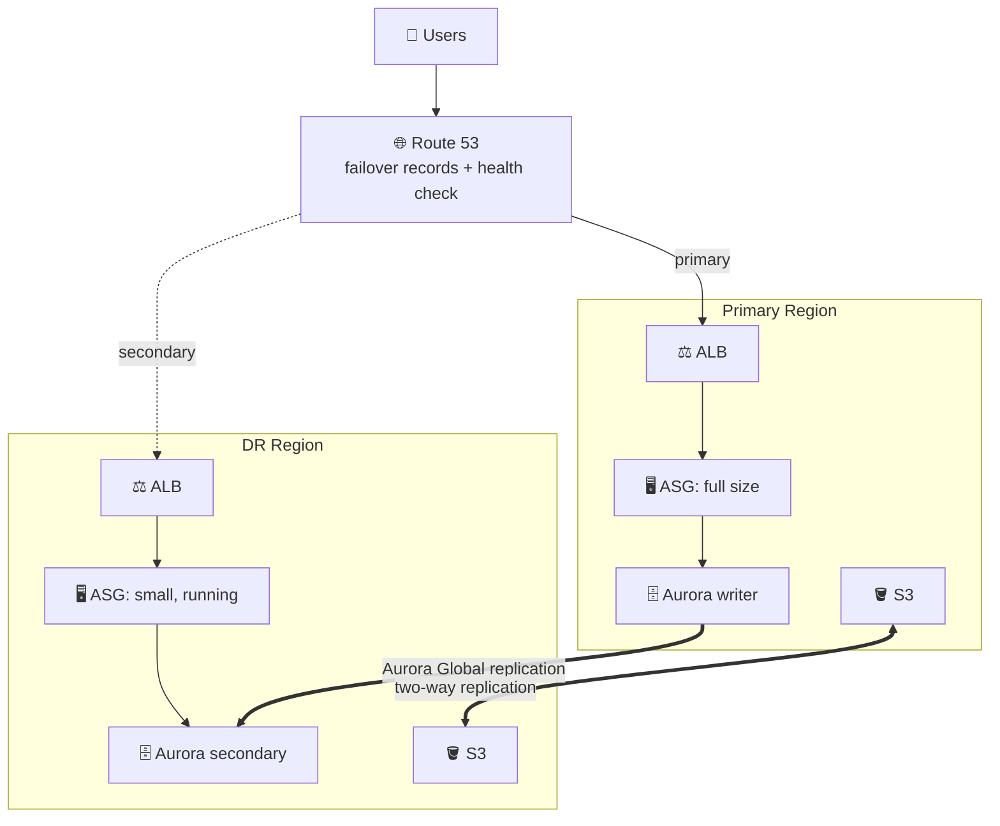
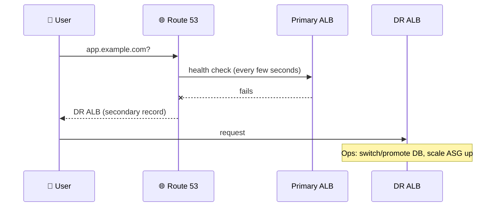

## What you build

A primary stack in one Region and a smaller but fully working copy in a DR Region. Data is replicated; DNS decides who gets traffic.


*Warm standby: the DR stack is always on and can serve a little traffic; failover means scale up and switch DNS.*

Concept background is in [AWS Disaster Recovery](/chapters/53-aws-disaster-recovery/). The previous lab, [Pilot Light](/chapters/56-lab-17-build-dr-site-on-aws-pilot-light/), had no running servers in DR; this one does. Next comes [Multi-Site Active-Active](/chapters/58-lab-17-build-dr-site-on-aws-multi-site-active-acti/).

The lab's own web app is not described in the course outline, so the app steps below are generic: any web app that reads a `DB_HOST` setting and stores files in S3 will do.

## Architecture


*DNS flips when the health check fails; the DR side is then scaled up.*

- **Golden AMI**: one prepared image with the app installed, reused in both Regions (copy it to the DR Region).
- **CloudFormation Mappings**: a lookup table from Region to AMI ID, so one template deploys both sites.
- **Aurora Global Database**: one primary Region holds the only active writer endpoint; secondary Regions have inactive writer endpoints. Replication is asynchronous, so a failover can lose the last few writes.
- **Route 53**: failover records (primary and secondary) plus a health check on the primary.
- **S3 two-way replication**: one rule each way between the two buckets; enable replica modification sync to also sync metadata changes.

| Scenario | RPO / RTO shape |
|---|---|
| Warm standby | Low RTO: already running, only scale up. RPO bounded by async replication lag |
| Pilot light | Higher RTO: must start servers first |

## Steps

Stages follow the lecture order. Use your own Regions, names and domain.

**Stage 1: Intro and sites**

1. Intro: read the architecture above and pick two Regions (for example primary in one, DR in another). Create the Aurora Global Database first, since both sites depend on it.
2. Setup DR site: in the DR Region create a VPC with subnets in at least two AZs, plus a secondary Aurora cluster added to the global database.
3. Setup primary site: the same in the primary Region, with the writer cluster, an ALB and an Auto Scaling group.
4. Understand the Aurora endpoint: note the cluster writer endpoint (active only in the primary) and the reader endpoint per Region. After a switchover the writer endpoint changes, unless you use the global writer endpoint, which follows the promoted cluster. DNS caching can delay the change.

```bash
aws rds describe-db-clusters --db-cluster-identifier my-cluster --query "DBClusters[0].[Endpoint,ReaderEndpoint]"
```

**Stage 2: Golden AMI and templates**

5. Build the golden AMI: launch an instance, install and test the app, then create an AMI. Copy it to the DR Region.
6. Update `DB_HOST`: make the app read the database host from an environment variable or parameter, not from the image.
7. CFN Mappings: add a `Mappings` block `Region -> AMI ID` and use `!FindInMap` in the launch template, so one template serves both Regions.

```yaml
Mappings:
  RegionMap:
    us-east-1: { AMI: ami-aaaa }
    us-west-2: { AMI: ami-bbbb }
# ImageId: !FindInMap [RegionMap, !Ref "AWS::Region", AMI]
```

8. Verify the primary with the new CloudFormation stack: open the ALB DNS name, create a record, confirm it is in the database.
9. Update the DR site: deploy the same template with small ASG sizes (for example min 1, desired 1), and `DB_HOST` set to the DR-side database endpoint. Browse the DR ALB to confirm it answers (reads work while the DR cluster is a read-only secondary).

**Stage 3: DNS and storage**

10. Route 53 simple routing: create one record to the primary ALB (alias). This shows a plain record has no failover; you edit it by hand.
11. Route 53 failover routing: create a health check on the primary ALB; create a primary failover record (with the health check) and a secondary one to the DR ALB. Lower the TTL so clients switch quickly.
12. S3 replication both ways: enable versioning on both buckets, then create a rule primary to DR and a second rule DR to primary, each with an IAM role.
13. Check the primary IP address: resolve the app name (`dig app.example.com`) and compare with the ALB's addresses, so you can tell which site is answering.

**Stage 4: Fail over and back**

14. Verify warm standby: simulate an outage (for example stop the primary ASG instances or fail the health check). Watch DNS return the DR ALB. In the DB, run a switchover (planned, console or CLI) or detach and promote the secondary (unplanned). Then raise the DR ASG desired and max capacity.
15. Failback: restore the primary, make it the writer again (switchover back, re-adding it to the global cluster if you detached it), scale DR down, and let health checks return DNS to the primary.

```bash
aws autoscaling update-auto-scaling-group --auto-scaling-group-name dr-asg --min-size 2 --desired-capacity 4 --max-size 6
```

Expected result: while primary is down, the app answers from the DR ALB; after failback, the primary serves again and DR is small again.

## Common mistakes

| Mistake | Fix |
|---|---|
| Health check on the DR record only | Put it on the primary record; a secondary without one is always treated as healthy |
| Hard-coded DB endpoint in the AMI | Pass `DB_HOST` at deploy time |
| AMI missing in DR Region | Copy the AMI there and map it per Region |
| Forgetting S3 versioning | Replication requires it on both buckets |
| Scaling DR but never promoting the DB | The app cannot write to a read-only secondary |
| High DNS TTL | Clients keep the old answer; use a low TTL |
| No VPC connectivity assumed for a global writer endpoint | The endpoint moves but apps still need a network path |

## Cleanup

Order matters; DR items cost money even when idle.

1. Route 53: delete the failover/simple records, then the health check.
2. S3: delete both replication rules, empty both buckets (all versions), delete them.
3. CloudFormation: delete the DR stack, then the primary stack (ASG, ALB, launch template).
4. Aurora: remove the secondary cluster from the global database, delete its instances and cluster, then the primary cluster, then the global database itself. Skip final snapshots if you do not need them.
5. EC2: deregister the golden AMIs in both Regions and delete their snapshots.
6. VPC and IAM leftovers (NAT gateways, Elastic IPs, replication role).
7. Check Cost Explorer next day for both Regions.

## On the job

- Warm standby costs more than pilot light because compute runs all the time, but it is easy to test with synthetic requests.
- Keep both sites on the same template and AMI; configuration drift is the usual reason failover fails.
- Rehearse: do a planned switchover on a schedule, and write a runbook with the scale-up commands.
- Health checks: automatic DNS failover is fast, but decide who authorizes DB promotion, because an unplanned failover can lose recent writes and risk split-brain.

## AWS docs

- [Disaster recovery options in the cloud (whitepaper)](https://docs.aws.amazon.com/whitepapers/latest/disaster-recovery-workloads-on-aws/disaster-recovery-options-in-the-cloud.html)
- [Connecting to Amazon Aurora Global Database](https://docs.aws.amazon.com/AmazonRDS/latest/AuroraUserGuide/aurora-global-database-connecting.html)
- [Replicating metadata changes with replica modification sync (S3)](https://docs.aws.amazon.com/AmazonS3/latest/userguide/replication-for-metadata-changes.html)
- [Route 53 failover routing troubleshooting](https://repost.aws/knowledge-center/route-53-fix-failover-policy-errors)
