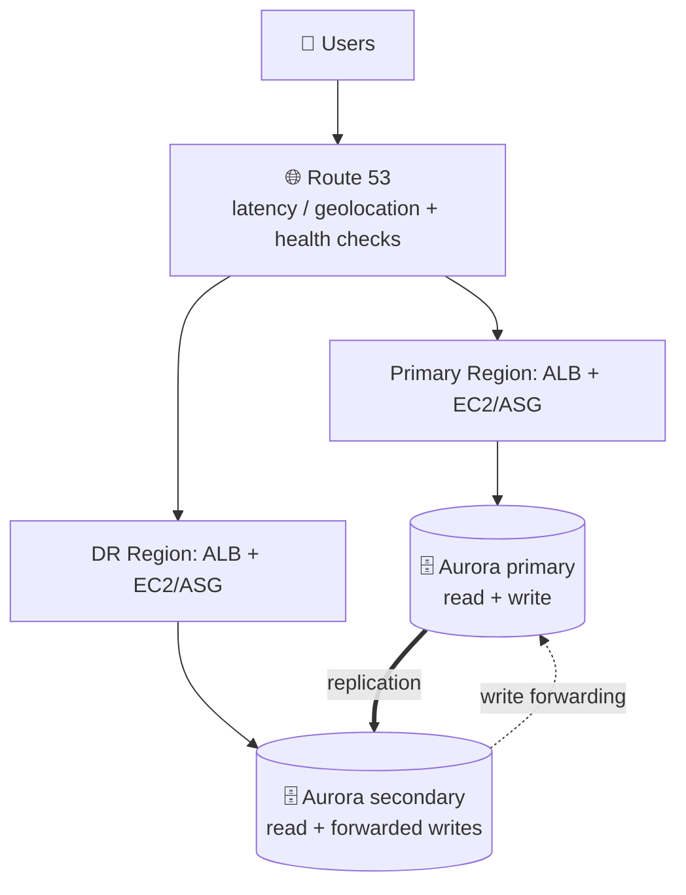
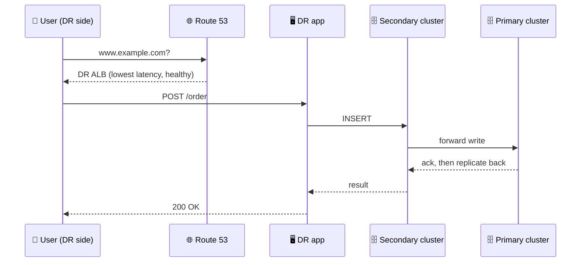
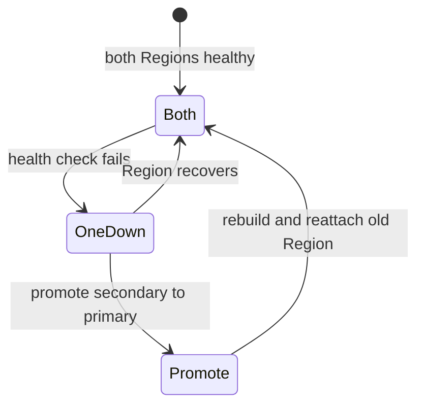

## What you build

Two full application stacks serve users at the same time: a primary Region and a DR Region. A global database sits underneath, and Route 53 splits users between the Regions.


*Both Regions take traffic; only the Aurora primary applies writes.*

This continues the previous lab, [warm standby](/chapters/57-lab-17-build-dr-site-on-aws-warm-standby-strategy/), where the DR site waited idle. For the strategy itself (RTO, RPO, the four DR patterns) see [AWS disaster recovery](/chapters/53-aws-disaster-recovery/). The lab's app details (AMI, templates, DB schema) are not in the docs, so steps stay generic and reuse what you built in lab 57.

## Architecture


*A write at the DR site travels to the primary and returns by replication.*

- **Aurora Global Database:** one primary cluster plus read-only secondary clusters in other Regions (check the current limit on secondaries). Replication is asynchronous.
- **Write forwarding:** the secondary accepts write SQL and forwards it; the primary is the source of truth, so no replication conflicts. Aurora handles the cross-Region connection.
- **Read consistency:** set `aurora_replica_read_consistency` to `EVENTUAL`, `SESSION` or `GLOBAL` on sessions that write. Without it, forwarding is not available (Aurora MySQL).
- **Route 53:** latency records send users to the closest healthy Region; geolocation records pin users by country or continent.
- **Health checks:** unhealthy records are dropped from answers, so users move to the other Region.

## Steps

Stages follow the lecture order.

**Stage 1: Understand write forwarding (3 lectures)**

1. Read the intro. "Local" write forwarding is inside one cluster (readers forward to the writer); "global" is across Regions in a global database. This lab uses global.
2. Aurora console > your global database > secondary cluster > Modify > enable **write forwarding**. CLI: `aws rds modify-db-cluster --db-cluster-identifier dr-cluster --enable-global-write-forwarding`.
3. Set `aurora_replica_read_consistency` (for example `SESSION`) in the secondary cluster parameter group or per session.

**Stage 2: Verify the DR site (2 lectures)**

4. From the DR app host, connect to the secondary cluster endpoint and run a `SELECT`. Expected: you see data written at the primary.
5. Run an `INSERT` through the same connection. Expected: it succeeds; check the row at the primary.

```sql
SET aurora_replica_read_consistency = 'SESSION';
INSERT INTO orders(item) VALUES ('test-dr');
```

**Stage 3: Setup and verify DR (2 lectures)**

6. Make the DR stack a full stack: same CloudFormation template as the primary, with desired capacity above zero (warm standby ran it minimal). The app uses the secondary's endpoint.
7. Open the DR ALB DNS name in a browser; confirm reads and writes work.

**Stage 4: Active-active routing (2 lectures)**

8. Route 53 > Health checks: one per Region (ALB DNS name, HTTP).
9. Hosted zone > create two alias A records with the same name, policy **Latency**, one per Region, each with its health check and **Evaluate target health = Yes**. Test from two places (or a VPN/other-Region EC2) and see different answers.
10. Replace them with **Geolocation** records (for example Asia to the DR Region, other locations to the primary) and add a **Default** record, otherwise unmatched locations get no answer.

**Stage 5: A rainy day (1 lecture)**

11. Break the primary: stop its app instances or block the health-check port. Wait for the health check to fail; confirm all users get the DR Region.
12. Note what still works: reads and app serving. Writes forwarded to a dead primary fail until you promote the secondary (global database failover, as in lab 57).

**Homework and cleanup (2 lectures):** try the same with DynamoDB global tables (below), then clean up.


*Failure lifecycle: DNS moves users in minutes; the database needs an explicit promote.*

## Data conflicts and failover

| | Aurora Global + write forwarding | DynamoDB global tables |
|---|---|---|
| Who accepts writes | Primary only (secondary forwards) | Every replica |
| Conflicts | None; one writer | Last writer wins (item level, by timestamp) |
| Cross-Region reads | Read consistency modes | Eventually consistent; strong only in the same Region (default mode) |
| Failover | Promote a secondary; DNS shifts users | No promote step; other replicas already take writes |
| Watch out | Write latency includes the cross-Region hop | Losing update is silently overwritten; conflicts are not logged |

- True "active-active writes" with local latency means DynamoDB global tables (or design data per Region). Aurora is active-active for reads and app serving, with one write location.
- Replication is asynchronous, so a Region loss can lose the last moments of writes (check the current Aurora and DynamoDB docs for lag figures).

## Common mistakes

| Mistake | Fix |
|---|---|
| Write fails at DR | Enable write forwarding on the cluster and set the read consistency parameter |
| Geolocation users get empty answers | Add a default record |
| DNS never fails over | Attach health checks and evaluate target health on every record |
| Health check says healthy but app is broken | Point it at a path that touches the database |
| Treating DNS failover as instant | Allow for record TTL and resolver caching; keep TTL low |
| Expecting database auto-failover | Promoting the secondary is a separate step |

## Cleanup

Active-active runs two full stacks, so cost is double. Order:

1. Route 53: delete the latency/geolocation records, then the health checks (and any test hosted zone you created).
2. Both Regions: delete the application stacks (CloudFormation delete removes ALB, ASG, instances), DR Region first.
3. Aurora: delete the secondary cluster's instances, then remove the secondary cluster from the global database and delete it.
4. Aurora: delete the primary cluster's instances and the primary cluster, then the global cluster itself (turn off deletion protection first).
5. S3: remove replication rules, empty and delete the buckets in both Regions.
6. Delete golden AMIs and their snapshots in both Regions, then extra IAM roles and CloudWatch alarms.
7. Next day, check Cost Explorer for Aurora, ALB and EC2 charges.

## On the job

- Active-active is the most expensive, lowest-RTO pattern; justify it with a business need.
- Data design decides success: decide per table whether one writer (Aurora) or last-writer-wins (DynamoDB) is acceptable.
- Test failover on a schedule; health checks that never fail in testing are unproven.
- I could not verify from the docs the exact write-forwarding limitations (supported versions, unsupported statements); read the page below before choosing it.

## AWS docs

- [Write forwarding in an Aurora global database](https://docs.aws.amazon.com/AmazonRDS/latest/AuroraUserGuide/aurora-global-database-write-forwarding.html)
- [Enabling local write forwarding (read consistency parameter)](https://docs.aws.amazon.com/AmazonRDS/latest/AuroraUserGuide/aurora-mysql-write-forwarding-enabling.html)
- [Route 53 health checks in complex configurations (latency + weighted)](https://docs.aws.amazon.com/Route53/latest/DeveloperGuide/dns-failover-complex-configs.html)
- [DynamoDB global tables: how it works](https://docs.aws.amazon.com/amazondynamodb/latest/developerguide/globaltables_HowItWorks.html)
