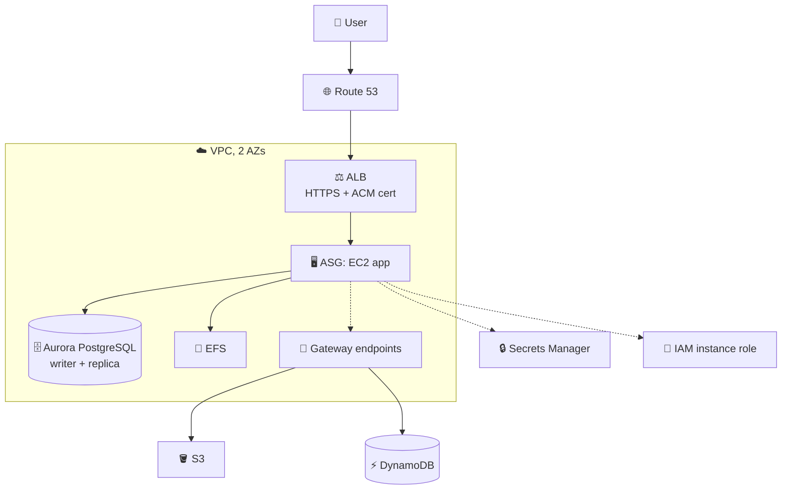
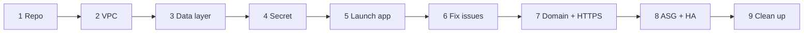
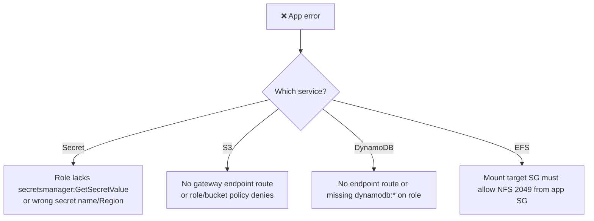
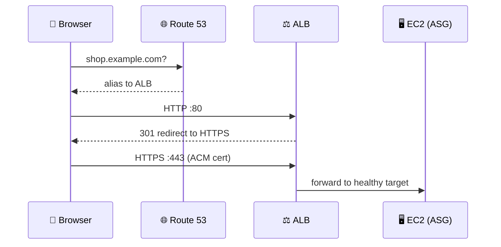

## What it is

The capstone assembles the whole course into one three-tier app: a web app on EC2 behind a load balancer, with Aurora PostgreSQL, DynamoDB, S3 and EFS as data stores. Then it hardens it with a custom domain, HTTPS, Auto Scaling and a multi-AZ database. You build it stage by stage and fix the permission and connection errors you hit on the way.

> Inferred from the lecture titles only (no lecture content available). The exact app and repo are in the lectures "Github Intro" and "Github Repo"; treat the shapes below as the likely design, not a copy of the course.

*Public edge (DNS, ALB), private app tier, and four data stores reached with an IAM role.*

Use this chapter when: you want a portfolio project that shows VPC, compute, data, security and HA in one place.

## Key concepts

### Build order

*Each stage works on its own; do not skip ahead until the previous one is verified.*

| # | Stage (lecture) | What you do | Revisit |
|---|---|---|---|
| 1 | GitHub intro and repo | Clone the sample app; read how it reads config (DB, bucket, table, mount) | [CI/CD services](/chapters/43-aws-devops-services/) |
| 2 | VPC setup | Public subnets for ALB, private for app and DB, across 2 AZs; route tables and security groups | [Networking basics](/chapters/05-networking-basic/), [VPC endpoints](/chapters/29-aws-networking-services-vpc-endpoints/) |
| 3 | Data layer: Aurora, DynamoDB, S3 | Create the Aurora cluster, a DynamoDB table and an S3 bucket | [Aurora](/chapters/21-aws-database-services-amazon-aurora/), [DynamoDB](/chapters/23-aws-database-services-amazon-dynamodb/), [S3](/chapters/14-aws-storage-services-amazon-s3/) |
| 4 | Secrets Manager for Aurora | Store the DB credential as a secret; allow the app role to read it | [IAM](/chapters/04-aws-identity-and-access-management-iam/), [Security services](/chapters/39-aws-security-services/) |
| 5 | Launch application, products table | Launch EC2 with an instance profile; create the products table in PostgreSQL | [EC2](/chapters/06-aws-compute-services-amazon-ec2/), [Lab 08](/chapters/22-lab-08-build-a-single-application-with-amazon-ec2/) |
| 6 | Three fix lectures | Debug secret, S3 and DynamoDB/EFS access (see below) | [EFS and FSx](/chapters/12-aws-storage-services-amazon-efs-and-fsx/), [CloudWatch](/chapters/28-aws-monitoring-amazon-cloudwatch-and-aws-cloudtrai/) |
| 7 | Route 53, ACM, HTTPS redirect | Domain, certificate, 443 listener, 80 to 443 redirect | [Edge services](/chapters/48-aws-edge-services/) |
| 8 | ASG and Aurora HA | Launch template + ASG behind the ALB; add an Aurora replica in a second AZ | [Auto Scaling](/chapters/26-aws-auto-scaling/), [3-tier lab](/chapters/07-lab-01-build-first-3-tiers-web-application-on-amaz/) |
| 9 | Clean up | Delete in reverse order (see Cheat sheet) | [IaC](/chapters/40-aws-operation-services-iac/) |

### The "fix it" lectures

*Almost every capstone failure is one of: IAM permission, missing network path, or security group.*

- **Secret.** Aurora can generate and manage its master password in Secrets Manager; the app role needs permission to read that secret.
- **S3 and DynamoDB.** From private subnets you need either NAT or a gateway endpoint; gateway endpoints add a prefix-list route to each subnet route table. Check the role policy too.
- **EFS.** The EFS cause (security group port 2049) is inferred from the title, not verified in the docs here.
- **Debug habit.** Read the app log in CloudWatch, then check role, route, security group in that order.

### Domain, HTTPS and scaling

*TLS ends at the ALB; instances can stay on plain HTTP inside the VPC.*

- **Route 53.** Use an alias record pointing to the ALB; it also works for the zone apex.
- **ACM.** Request a public certificate (DNS validation is the usual route) and attach it to the HTTPS listener.
- **ASG.** Spread instances over 2 AZs, register to the ALB target group, scale on a metric.
- **Aurora HA.** Add a reader in another AZ so the cluster can fail over; the app keeps using the cluster endpoints.

## Cheat sheet

- Order: repo, VPC, data, secret, app, fixes, domain, HTTPS, ASG, Aurora HA, cleanup.
- Errors: IAM, then route/endpoint, then security group.
- ALB: 443 listener with ACM cert, 80 listener redirects to 443.
- Route 53 alias record to the ALB, not an IP.
- Cleanup order: ASG (set 0) and ALB, Route 53 records, Aurora instances then cluster (no final snapshot if unwanted), DynamoDB, S3 (empty first), EFS, endpoints, NAT/VPC, secret, ACM cert.
- Not verified here: exact app, instance sizes and cleanup order of the course.

## AWS docs

- [Password management with Aurora and Secrets Manager](https://docs.aws.amazon.com/AmazonRDS/latest/AuroraUserGuide/rds-secrets-manager.html)
- [Gateway endpoints for S3 and DynamoDB](https://docs.aws.amazon.com/vpc/latest/privatelink/gateway-endpoints.html)
- [Redirect HTTP to HTTPS on an ALB](https://repost.aws/knowledge-center/elb-redirect-http-to-https-using-alb)
- [Route 53 FAQs: alias to a load balancer](https://aws.amazon.com/route53/faqs/)
