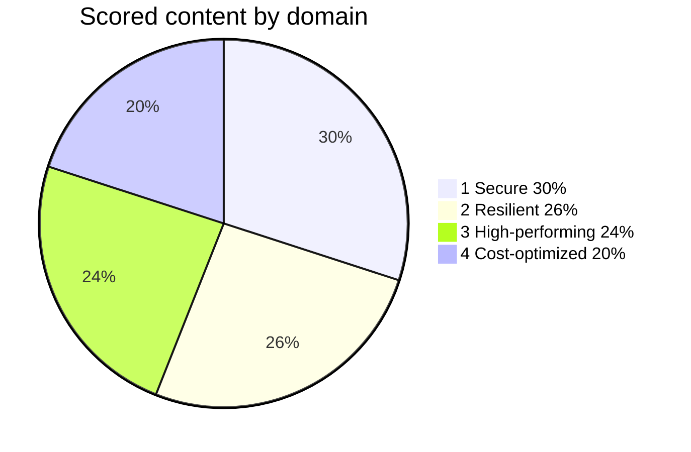
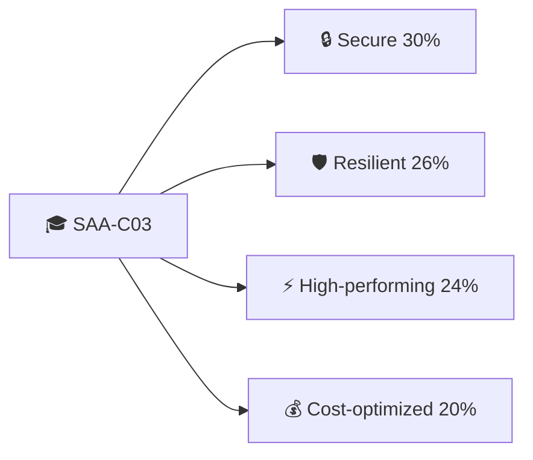
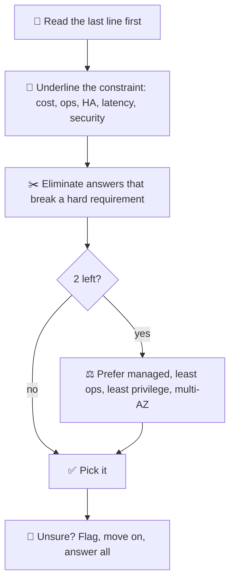
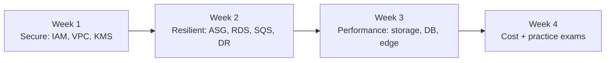

## What it is

SAA-C03 (AWS Certified Solutions Architect - Associate) tests whether you can design secure, resilient, high-performing and cost-optimized architectures. This page is a compact map from the exam to the chapters you already read. Always check the current exam guide: AWS changes exams, and the guide below listed SAA-C03 as the current version when this was written (October 2026).

| Item | Value (per AWS) |
|---|---|
| Format | 65 questions: multiple choice (1 of 4) or multiple response (2+ of 5+) |
| Duration | 130 minutes |
| Scored questions | 50 scored + 15 unscored (not identified) |
| Scoring | Scaled 100-1000, pass at 720, compensatory (no per-domain pass) |
| Guessing | Unanswered = wrong, no penalty: always answer |
| Cost / validity | 150 USD, valid 3 years; Pearson VUE center or online proctored |

*Security is the biggest slice; every domain still matters.*

## Key concepts

### Domain to chapters map

*Four domains; the table shows where this course taught each one.*

| Domain | Read these chapters |
|---|---|
| Secure | [IAM](/chapters/04-aws-identity-and-access-management-iam/), [VPC basics](/chapters/05-networking-basic/), [Security services (KMS, WAF, Shield)](/chapters/39-aws-security-services/), [Multi-account](/chapters/52-multi-account-strategy/), [VPC endpoints](/chapters/29-aws-networking-services-vpc-endpoints/), [PrivateLink](/chapters/33-aws-networking-services-aws-privatelink/) |
| Resilient | [Auto Scaling](/chapters/26-aws-auto-scaling/), [Messaging](/chapters/37-aws-serverless-services-messaging-services/), [RDS](/chapters/20-aws-database-services-amazon-rds/), [Aurora](/chapters/21-aws-database-services-amazon-aurora/), [Disaster recovery](/chapters/53-aws-disaster-recovery/), [Monitoring](/chapters/28-aws-monitoring-amazon-cloudwatch-and-aws-cloudtrai/) |
| High-performing | [EC2](/chapters/06-aws-compute-services-amazon-ec2/), [Lambda and containers](/chapters/08-aws-computes-aws-lambda-and-containers/), [EBS](/chapters/10-aws-storage-services-aws-ebs/), [EFS and FSx](/chapters/12-aws-storage-services-amazon-efs-and-fsx/), [S3](/chapters/14-aws-storage-services-amazon-s3/), [DynamoDB](/chapters/23-aws-database-services-amazon-dynamodb/), [Caching](/chapters/24-aws-database-caching-and-migration/), [Edge](/chapters/48-aws-edge-services/), [Serverless](/chapters/35-aws-serverless-services-lambda-and-dynamodb-and-ap/), [Transit Gateway](/chapters/31-aws-networking-services-aws-transit-gateway/), [Hybrid](/chapters/32-aws-networking-services-hybrid-connections/) |
| Cost-optimized | Pricing notes in every chapter: [EC2 purchase options](/chapters/06-aws-compute-services-amazon-ec2/), [S3 classes](/chapters/14-aws-storage-services-amazon-s3/), [Data transfer](/chapters/34-aws-data-transfer/), [Aurora billing](/chapters/21-aws-database-services-amazon-aurora/) |

### Keyword to service cheat sheet

Facts below come from the chapters above.

| Question says | Think |
|---|---|
| Decouple, buffer, pull | SQS |
| Strictly ordered, no duplicates | SQS FIFO |
| Push to many subscribers (fan-out) | SNS (+ SQS queues) |
| Route events by content / schedule | EventBridge |
| In-memory cache, microsecond reads | ElastiCache; DAX for DynamoDB |
| Key-value, any scale, serverless | DynamoDB |
| Relational, managed, HA | RDS Multi-AZ; Aurora for shared storage and up to 15 replicas |
| Scale reads | Read replicas |
| Shared Linux files across AZs | EFS |
| Windows SMB / HPC with S3 | FSx for Windows / FSx for Lustre |
| Block disk for one instance, IOPS | EBS (gp3 default, io2 high IOPS) |
| Object storage, archive tiers | S3 + lifecycle to Glacier classes |
| Private access to S3/DynamoDB, no NAT cost | Gateway endpoint |
| Expose one service privately to other VPCs/accounts | PrivateLink |
| Many VPCs and on-premises hub | Transit Gateway |
| Quick encrypted link / steady private link | Site-to-Site VPN / Direct Connect |
| Block SQL injection, layer 7 | WAF |
| Encrypt at rest, key control | KMS |
| Global static IPs, TCP/UDP | Global Accelerator |
| Cache content at the edge, HTTPS | CloudFront |
| Many accounts, central guardrails | Organizations + SCPs |
| Who called the API? | CloudTrail |
| Metrics and alarms | CloudWatch |
| Spiky unknown traffic, no servers | Lambda + API Gateway |
| Cheapest fault-tolerant compute | Spot |
| Migrate a database | DMS |
| Unneeded servers, least ops | Managed / serverless |

### Reading a question

*Constraints decide the answer, not familiarity with a service.*

- Multiple-response questions say how many answers to choose; pick exactly that many.
- Budget about 2 minutes per question (130 minutes for 65) and use the review flag.
- "Most cost-effective" with steady load means commitments; with fault-tolerant work means Spot.

### Practice tests and certification advice

- **Practice test.** Use the practice test that comes with the Udemy course, plus AWS's free official practice question set (see the certification page). Review every wrong answer by reading the matching chapter, not by memorizing the answer.
- **Do you need it?** Employers value hands-on skill; the certificate is a screening signal. AWS recommends at least 1 year of hands-on experience, and Cloud Practitioner first if you have no IT experience.
- **After passing.** AWS lists a 50% discount on your next exam and 3 years of validity.

### Study plan

*Four weeks at about 1 hour a day is a realistic side-goal pace.*

1. Read the domain chapters in the table; redo one lab per domain.
2. Take a practice test untimed, then timed.
3. Repeat weak chapters; stop when you score comfortably above the pass level repeatedly.

## Cheat sheet

- 65 questions, 130 min, 50 scored, pass 720 of 1000, compensatory scoring.
- Weights: Secure 30, Resilient 26, High-performing 24, Cost 20.
- Never leave a question blank: no penalty for guessing.
- Keywords: decouple SQS, ordered FIFO, fan-out SNS, cache ElastiCache/DAX, S3 and DynamoDB private access via gateway endpoint.
- Qualifiers win: least ops = managed; cheapest = right purchase option; HA = multi-AZ.
- Check the current exam guide and price before booking.

## AWS docs

- [SAA-C03 exam guide](https://docs.aws.amazon.com/aws-certification/latest/solutions-architect-associate-03/solutions-architect-associate-03.html)
- [AWS certification exam guides](https://docs.aws.amazon.com/aws-certification/latest/examguides/aws-certification-exam-guides.html)
- Certification overview page: [aws.amazon.com/certification](https://aws.amazon.com/certification/certified-solutions-architect-associate/)
