Start from the **need**, follow the flowchart, then confirm in the table. Every row links to the chapter that teaches the details. Prices and quotas are not repeated here; check the chapters and AWS pages.

Rule of thumb from the chapters: pick the simplest service that meets the need, and the highest layer that works.

## Compute

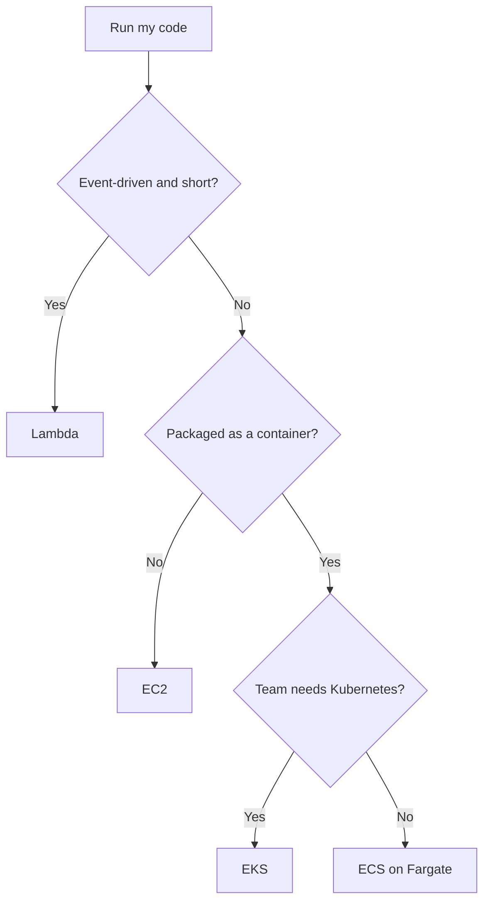

| I need to… | Use | Because | Read |
| --- | --- | --- | --- |
| Control the OS, run steady servers, licensed software | EC2 | Full control; you manage OS, patches, scaling | [chapter 06](/chapters/06-aws-compute-services-amazon-ec2/) |
| Run short, bursty, event-driven code | Lambda | Code only; pay per request and GB-second; up to 15 min per call | [chapter 08](/chapters/08-aws-computes-aws-lambda-and-containers/) |
| Run a long-running container with no servers | ECS on Fargate | You manage the image and task size only | [chapter 08](/chapters/08-aws-computes-aws-lambda-and-containers/) |
| Use Kubernetes skills or portability | EKS | Kubernetes ecosystem, at the cost of more concepts and a cluster fee | [chapter 08](/chapters/08-aws-computes-aws-lambda-and-containers/) |
| Log in to a private instance with no open port | Session Manager | No inbound port, no key pair, IAM controlled | [chapter 06](/chapters/06-aws-compute-services-amazon-ec2/) |
| Licence or compliance per physical host | Dedicated Host | Per host; Dedicated Instance is only isolation | [chapter 06](/chapters/06-aws-compute-services-amazon-ec2/) |
| Right-size instances | Compute Optimizer | Rightsizing advice (opt in) | [chapter 08](/chapters/08-aws-computes-aws-lambda-and-containers/) |

## Containers & serverless

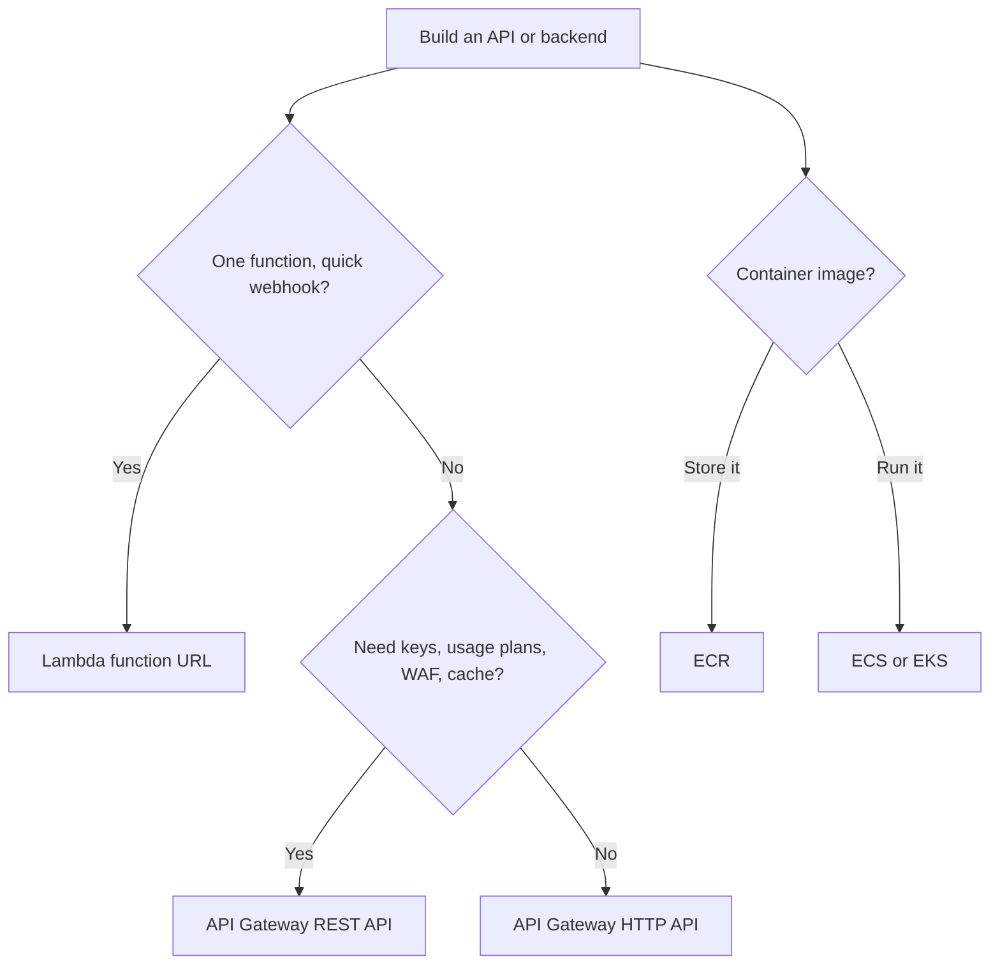

| I need to… | Use | Because | Read |
| --- | --- | --- | --- |
| Expose one function quickly | Lambda function URL | One endpoint per function, no extra charge beyond Lambda | [chapter 35](/chapters/35-aws-serverless-services-lambda-and-dynamodb-and-ap/) |
| Cheap proxy to Lambda with JWT auth | API Gateway HTTP API | Lower price, built-in JWT, auto CORS | [chapter 35](/chapters/35-aws-serverless-services-lambda-and-dynamodb-and-ap/) |
| API keys, usage plans, validation, WAF, stage cache | API Gateway REST API | Full API management features | [chapter 35](/chapters/35-aws-serverless-services-lambda-and-dynamodb-and-ap/) |
| Two-way real-time routes | API Gateway WebSocket | WebSocket API type | [chapter 35](/chapters/35-aws-serverless-services-lambda-and-dynamodb-and-ap/) |
| Store container images | ECR | ECR stores images; ECS and EKS schedule them | [chapter 08](/chapters/08-aws-computes-aws-lambda-and-containers/) |
| Remove container servers | Fargate | Serverless compute for containers | [chapter 09](/chapters/09-lab-02-build-your-first-container-cluster-with-ama/) |
| Avoid cold starts on Lambda | Provisioned concurrency | Pre-warmed and paid; reserved concurrency is only a free guarantee and cap | [chapter 08](/chapters/08-aws-computes-aws-lambda-and-containers/) |
| Upload code and let AWS run the stack | Elastic Beanstalk | AWS runs EC2, load balancer and scaling | [chapter 40](/chapters/40-aws-operation-services-iac/) |

## Block, file & object storage

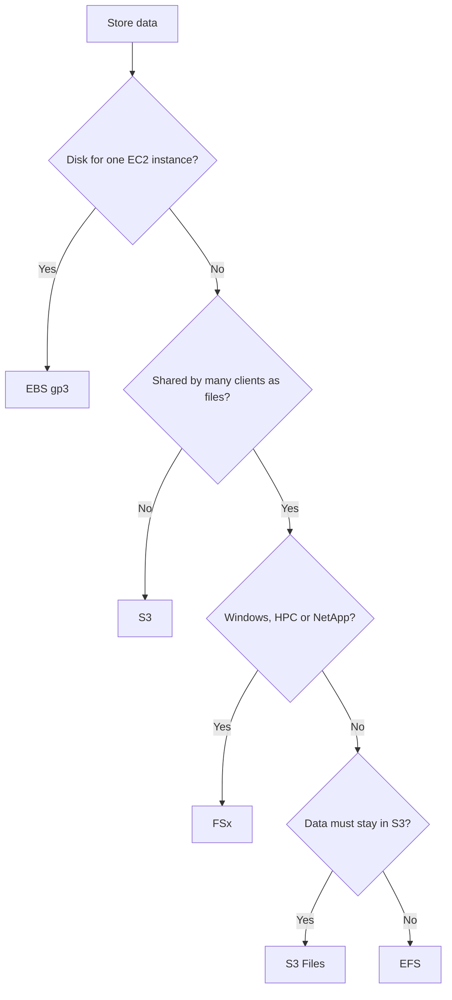

| I need to… | Use | Because | Read |
| --- | --- | --- | --- |
| A boot or database disk for one instance | EBS gp3 | Default type; network disk that survives stop | [chapter 10](/chapters/10-aws-storage-services-aws-ebs/) |
| The top IOPS, durability or Multi-Attach | EBS io2 | Beyond gp3 limits; Multi-Attach | [chapter 10](/chapters/10-aws-storage-services-aws-ebs/) |
| Scratch space that can be lost | Instance store | Local to the host; lost on stop and terminate | [chapter 10](/chapters/10-aws-storage-services-aws-ebs/) |
| Shared Linux files for many servers | EFS | Elastic NFS shared across AZs | [chapter 12](/chapters/12-aws-storage-services-amazon-efs-and-fsx/) |
| Windows SMB or HPC Lustre shares | FSx | Windows, Lustre, ONTAP or OpenZFS flavors | [chapter 12](/chapters/12-aws-storage-services-amazon-efs-and-fsx/) |
| Files, backups, static sites, data lakes | S3 | Objects over an API, any size | [chapter 14](/chapters/14-aws-storage-services-amazon-s3/) |
| Cheapest long-term archive | S3 Glacier Deep Archive | Cheapest class; retrieval in hours | [chapter 14](/chapters/14-aws-storage-services-amazon-s3/) |
| A bucket that behaves like a shared file system | S3 Files | File and S3 API access to the same data | [chapter 18](/chapters/18-amazon-s3-files-new/) |

## Databases

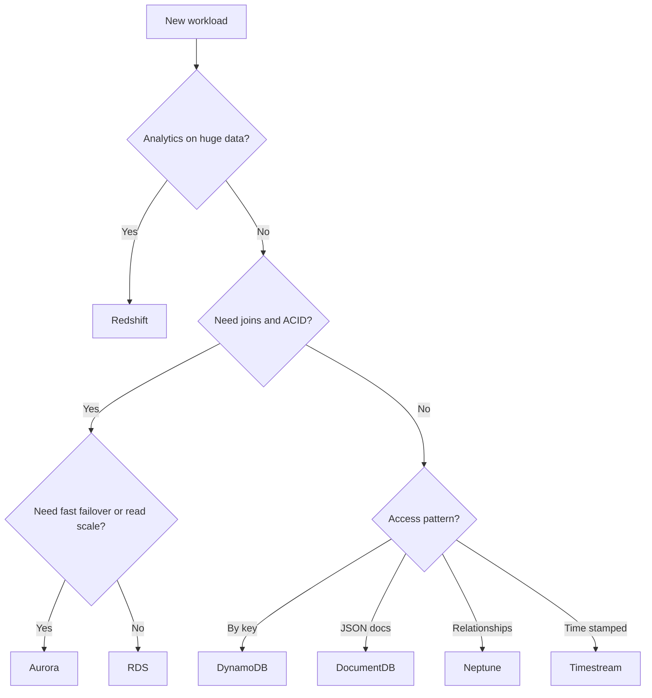

| I need to… | Use | Because | Read |
| --- | --- | --- | --- |
| SQL with Oracle, SQL Server, MariaDB or Db2 | RDS | Only RDS has those engines; Aurora is MySQL/PostgreSQL only | [chapter 20](/chapters/20-aws-database-services-amazon-rds/) |
| Survive an AZ failure on RDS | Multi-AZ | Synchronous standby, automatic failover | [chapter 20](/chapters/20-aws-database-services-amazon-rds/) |
| Scale reads or copy to another Region | Read replica | Asynchronous, serves reads, manual promote | [chapter 20](/chapters/20-aws-database-services-amazon-rds/) |
| More scale, about 30 s failover, growing storage | Aurora | Shared volume, 6 copies in 3 AZs, up to 15 replicas | [chapter 21](/chapters/21-aws-database-services-amazon-aurora/) |
| Spiky or unpredictable Aurora load | Aurora Serverless | ACU range scales in place | [chapter 21](/chapters/21-aws-database-services-amazon-aurora/) |
| Key-value access at huge scale | DynamoDB | No servers, single-digit ms, design by access pattern | [chapter 23](/chapters/23-aws-database-services-amazon-dynamodb/) |
| Unknown traffic on DynamoDB | On-demand mode | Per request; provisioned is for steady, forecast load | [chapter 23](/chapters/23-aws-database-services-amazon-dynamodb/) |
| Pick by data model (graph, time series, Cassandra, MongoDB) | Neptune, Timestream, Keyspaces, DocumentDB | Match the model to the engine | [chapter 19](/chapters/19-aws-database-services-intro/) |

## Caching & migration

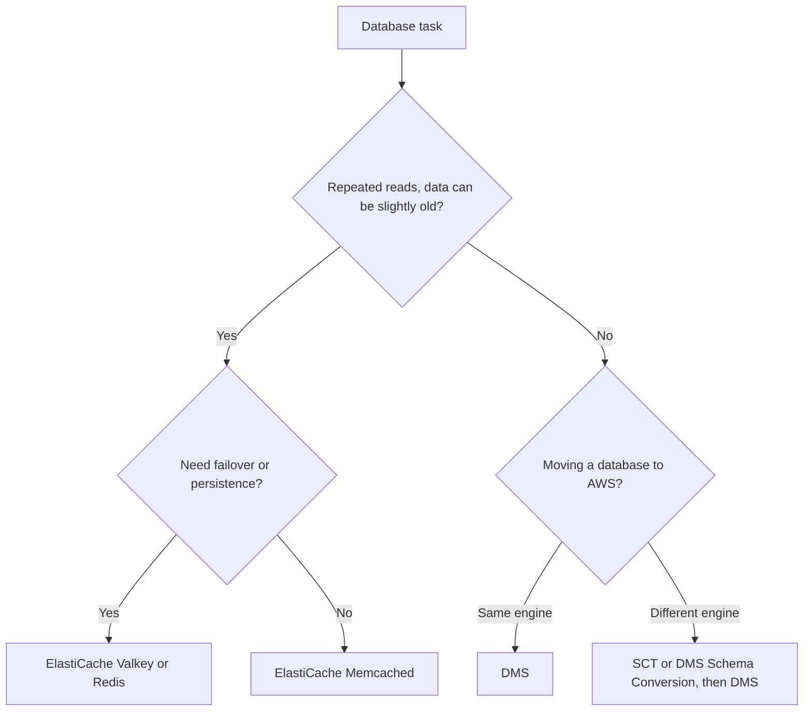

| I need to… | Use | Because | Read |
| --- | --- | --- | --- |
| Cache with failover, persistence, sorted sets | ElastiCache Valkey/Redis | Replication, snapshots, rich types | [chapter 24](/chapters/24-aws-database-caching-and-migration/) |
| Simplest scale-out object cache | ElastiCache Memcached | Multithreaded, add nodes; no failover | [chapter 24](/chapters/24-aws-database-caching-and-migration/) |
| Microsecond cached reads for DynamoDB | DAX | Cache built for DynamoDB | [chapter 23](/chapters/23-aws-database-services-amazon-dynamodb/) |
| Move a database with little downtime | DMS | Full load plus change capture; source stays online | [chapter 24](/chapters/24-aws-database-caching-and-migration/) |
| Convert schema and code between engines | SCT or DMS Schema Conversion | SCT runs locally; DMS SC is managed in the console | [chapter 24](/chapters/24-aws-database-caching-and-migration/) |
| Pool connections from Lambda to RDS | RDS Proxy | Pools connections; IAM and Secrets Manager | [chapter 20](/chapters/20-aws-database-services-amazon-rds/) |

## Network connectivity

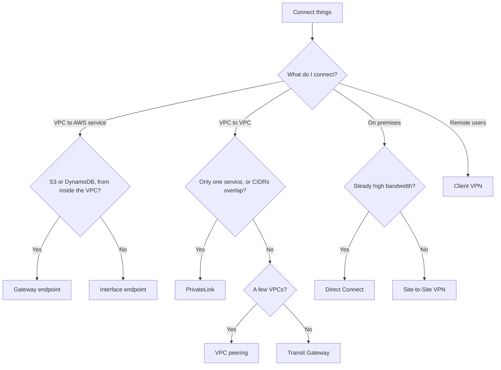

| I need to… | Use | Because | Read |
| --- | --- | --- | --- |
| Reach S3 or DynamoDB from private subnets for free | Gateway endpoint | Route table entry, free, VPC only | [chapter 29](/chapters/29-aws-networking-services-vpc-endpoints/) |
| Private access to other services or from on premises | Interface endpoint | ENI with private IP; hourly plus per GB | [chapter 29](/chapters/29-aws-networking-services-vpc-endpoints/) |
| Reach the public internet from a private subnet | NAT gateway | Outbound only; for third-party destinations | [chapter 05](/chapters/05-networking-basic/) |
| A few VPCs with full, cheap, direct access | VPC peering | No hourly fee; not transitive | [chapter 30](/chapters/30-aws-networking-services-vpc-peering/) |
| Many VPCs, hybrid sharing, segmentation | Transit Gateway | Hub and spoke, transitive routing | [chapter 31](/chapters/31-aws-networking-services-aws-transit-gateway/) |
| Expose one service, or overlapping CIDRs | PrivateLink | One way, no routing, overlap allowed | [chapter 33](/chapters/33-aws-networking-services-aws-privatelink/) |
| Connect a site fast or as backup | Site-to-Site VPN | Minutes to set up, encrypted, two tunnels | [chapter 32](/chapters/32-aws-networking-services-hybrid-connections/) |
| Steady, large, low-jitter hybrid traffic | Direct Connect | Dedicated circuit; not encrypted by default | [chapter 32](/chapters/32-aws-networking-services-hybrid-connections/) |

## Load balancing & scaling

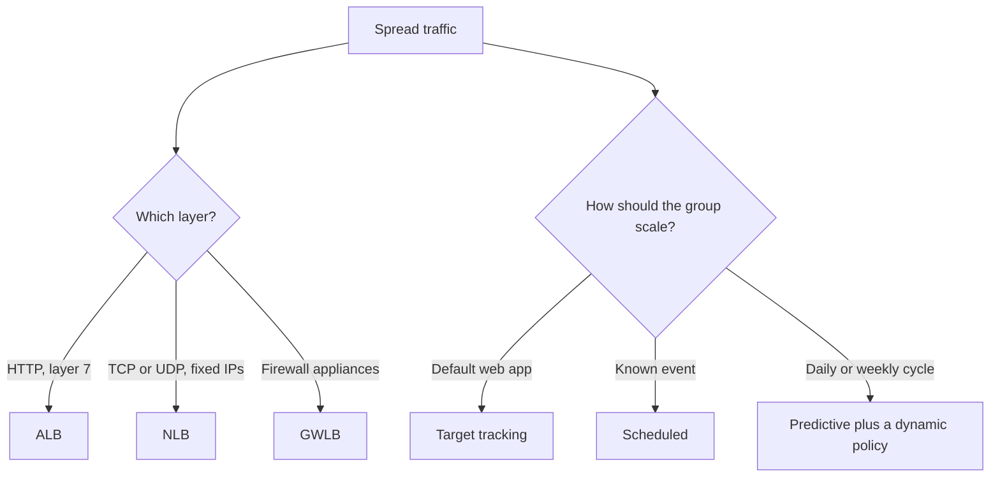

| I need to… | Use | Because | Read |
| --- | --- | --- | --- |
| Route HTTP traffic to web instances | ALB | HTTP layer 7 | [chapter 26](/chapters/26-aws-auto-scaling/) |
| Fixed IP per AZ or TCP/UDP | NLB | Layer 4 with static IPs | [chapter 07](/chapters/07-lab-01-build-first-3-tiers-web-application-on-amaz/) |
| Insert third-party firewalls | GWLB | Layer 3, GENEVE | [chapter 26](/chapters/26-aws-auto-scaling/) |
| Control how many instances exist | Auto Scaling group | ELB spreads traffic, ASG sizes and replaces | [chapter 26](/chapters/26-aws-auto-scaling/) |
| Default scaling policy | Target tracking | Managed alarms, scales in and out | [chapter 26](/chapters/26-aws-auto-scaling/) |
| Bigger reaction to bigger breach | Step scaling | Steps by alarm size | [chapter 26](/chapters/26-aws-auto-scaling/) |
| Known peaks (sale, 9:00 start) | Scheduled scaling | Date and time driven | [chapter 26](/chapters/26-aws-auto-scaling/) |
| Recurring cycles | Predictive scaling | Forecast from history; scale-out only | [chapter 26](/chapters/26-aws-auto-scaling/) |

## Messaging & integration

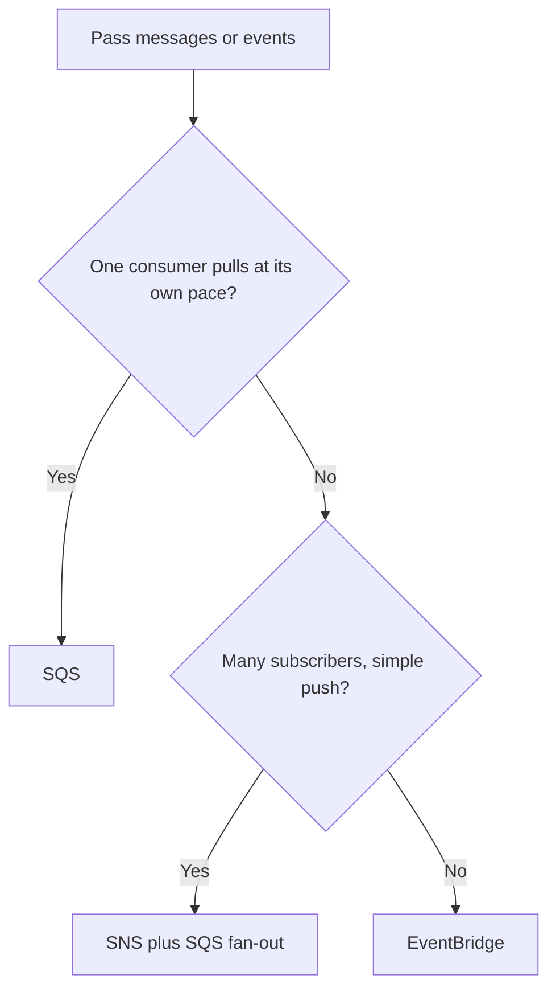

| I need to… | Use | Because | Read |
| --- | --- | --- | --- |
| Buffer work so consumers scale at their pace | SQS | Stores up to 14 days; consumer pulls | [chapter 37](/chapters/37-aws-serverless-services-messaging-services/) |
| Send one event to many systems | SNS | Pub/sub push, filter policies | [chapter 37](/chapters/37-aws-serverless-services-messaging-services/) |
| Route by content, react to AWS or SaaS events | EventBridge | Rules and event patterns; default bus gets AWS events | [chapter 37](/chapters/37-aws-serverless-services-messaging-services/) |
| Run a task on a schedule | EventBridge | Schedules are an EventBridge feature | [chapter 38](/chapters/38-lab-12-automation-with-amazon-eventbridge-schedule/) |
| Strict order or no duplicates | FIFO queue or topic | Ordered per message group; exactly-once processing | [chapter 37](/chapters/37-aws-serverless-services-messaging-services/) |
| Keep failed messages for inspection | Dead-letter queue | Redrive policy with maxReceiveCount | [chapter 37](/chapters/37-aws-serverless-services-messaging-services/) |
| Many subscribers, each with its own buffer | SNS plus SQS | Fan-out to queues | [chapter 37](/chapters/37-aws-serverless-services-messaging-services/) |

## Security & encryption

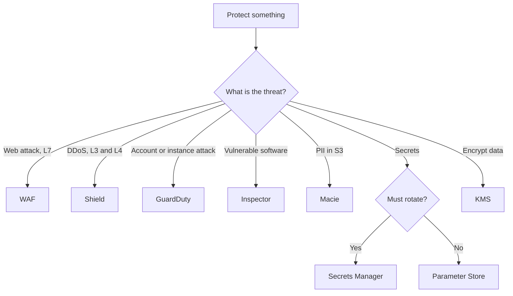

| I need to… | Use | Because | Read |
| --- | --- | --- | --- |
| Create and control encryption keys | KMS | At rest; customer managed key to set policy or rotation | [chapter 39](/chapters/39-aws-security-services/) |
| Issue TLS certificates | ACM | Issues and renews certificates | [chapter 39](/chapters/39-aws-security-services/) |
| Block SQL injection, XSS, bad bots | WAF | Layer 7 HTTP filtering | [chapter 39](/chapters/39-aws-security-services/) |
| Rotate database passwords | Secrets Manager | Built-in Lambda-driven rotation | [chapter 39](/chapters/39-aws-security-services/) |
| Store plain config values | Parameter Store | No built-in rotation; for config | [chapter 39](/chapters/39-aws-security-services/) |
| Give a workload temporary access | IAM role | Temporary STS credentials, no long-term keys | [chapter 04](/chapters/04-aws-identity-and-access-management-iam/) |
| Set a hard cap on permissions | SCP, boundary | Caps only; explicit Deny beats Allow | [chapter 04](/chapters/04-aws-identity-and-access-management-iam/) |
| One place for findings | Security Hub | Collects findings together | [chapter 39](/chapters/39-aws-security-services/) |

## Monitoring & audit

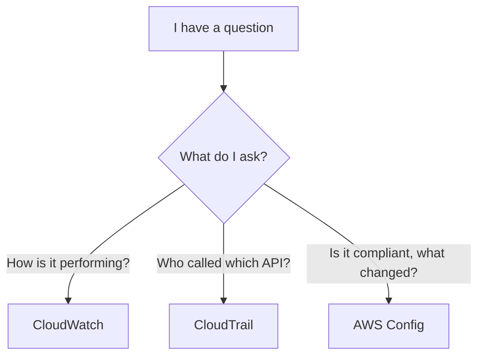

| I need to… | Use | Because | Read |
| --- | --- | --- | --- |
| Alarm on CPU, errors, latency | CloudWatch alarms | Metrics, logs and alarms | [chapter 28](/chapters/28-aws-monitoring-amazon-cloudwatch-and-aws-cloudtrai/) |
| Memory or disk-used metrics | CloudWatch agent | Not available without the agent | [chapter 28](/chapters/28-aws-monitoring-amazon-cloudwatch-and-aws-cloudtrai/) |
| Search logs, alert from log patterns | Logs Insights, metric filters | Query logs; filters turn logs into alarms | [chapter 28](/chapters/28-aws-monitoring-amazon-cloudwatch-and-aws-cloudtrai/) |
| Find who deleted something | CloudTrail | API activity; 90 days of event history, free | [chapter 28](/chapters/28-aws-monitoring-amazon-cloudwatch-and-aws-cloudtrai/) |
| Keep audit history long term | CloudTrail trail to S3 | Event history is only 90 days | [chapter 28](/chapters/28-aws-monitoring-amazon-cloudwatch-and-aws-cloudtrai/) |
| SQL over events | CloudTrail Lake | SQL over events | [chapter 28](/chapters/28-aws-monitoring-amazon-cloudwatch-and-aws-cloudtrai/) |
| Check configuration and drift | AWS Config | Configuration items and compliance | [chapter 28](/chapters/28-aws-monitoring-amazon-cloudwatch-and-aws-cloudtrai/) |

## Edge & DNS

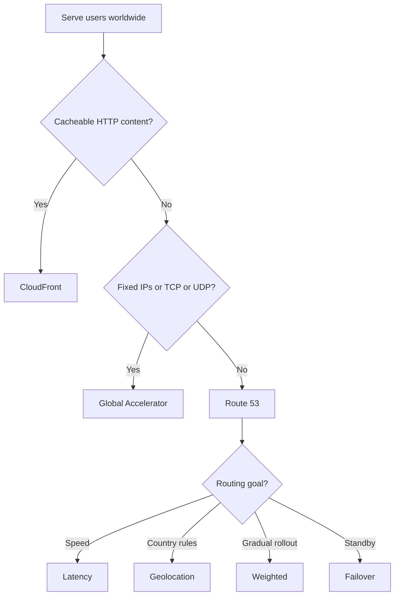

| I need to… | Use | Because | Read |
| --- | --- | --- | --- |
| Cache and deliver content, signed URLs, edge code | CloudFront | Cache, OAC, CloudFront Functions, Lambda@Edge | [chapter 48](/chapters/48-aws-edge-services/) |
| Static anycast IPs or non-HTTP traffic | Global Accelerator | TCP/UDP, no cache, health-based failover | [chapter 48](/chapters/48-aws-edge-services/) |
| Send users to the fastest Region | Route 53 latency | Lowest latency Region | [chapter 48](/chapters/48-aws-edge-services/) |
| Rules based on user country | Route 53 geolocation | Country or continent | [chapter 48](/chapters/48-aws-edge-services/) |
| Canary or A/B rollout | Route 53 weighted | Your percentages | [chapter 48](/chapters/48-aws-edge-services/) |
| Active-passive DR | Route 53 failover | Primary health check required | [chapter 48](/chapters/48-aws-edge-services/) |
| HTTPS in front of an S3 static site | CloudFront | S3 static site is HTTP only | [chapter 14](/chapters/14-aws-storage-services-amazon-s3/) |
| Compute near a city or in your site | Local Zone, Outposts | Local Zone near a city; Outposts is an AWS rack on site | [chapter 48](/chapters/48-aws-edge-services/) |

## Data transfer

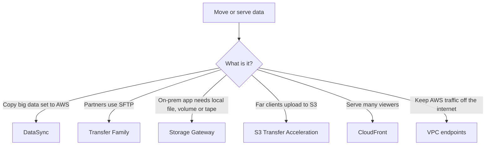

| I need to… | Use | Because | Read |
| --- | --- | --- | --- |
| Managed copy from on premises to S3, EFS, FSx | DataSync | Scheduled, validates integrity | [chapter 34](/chapters/34-aws-data-transfer/) |
| Accept SFTP, FTPS, FTP or AS2 | Transfer Family | Managed endpoints, no servers | [chapter 34](/chapters/34-aws-data-transfer/) |
| Keep local protocols while data lives in AWS | Storage Gateway | File, Volume and Tape gateways | [chapter 34](/chapters/34-aws-data-transfer/) |
| Faster long-distance uploads to S3 | S3 Transfer Acceleration | Uses edge locations | [chapter 34](/chapters/34-aws-data-transfer/) |
| Cheaper downloads | CloudFront | AWS origin to CloudFront is free | [chapter 34](/chapters/34-aws-data-transfer/) |
| Offline petabyte move | Snow family | Not offered to new customers per the docs; verify | [chapter 34](/chapters/34-aws-data-transfer/) |
| Understand what costs money | Data transfer rules | In is free; out to internet, cross-AZ, cross-Region are paid | [chapter 34](/chapters/34-aws-data-transfer/) |

## IaC & CI/CD

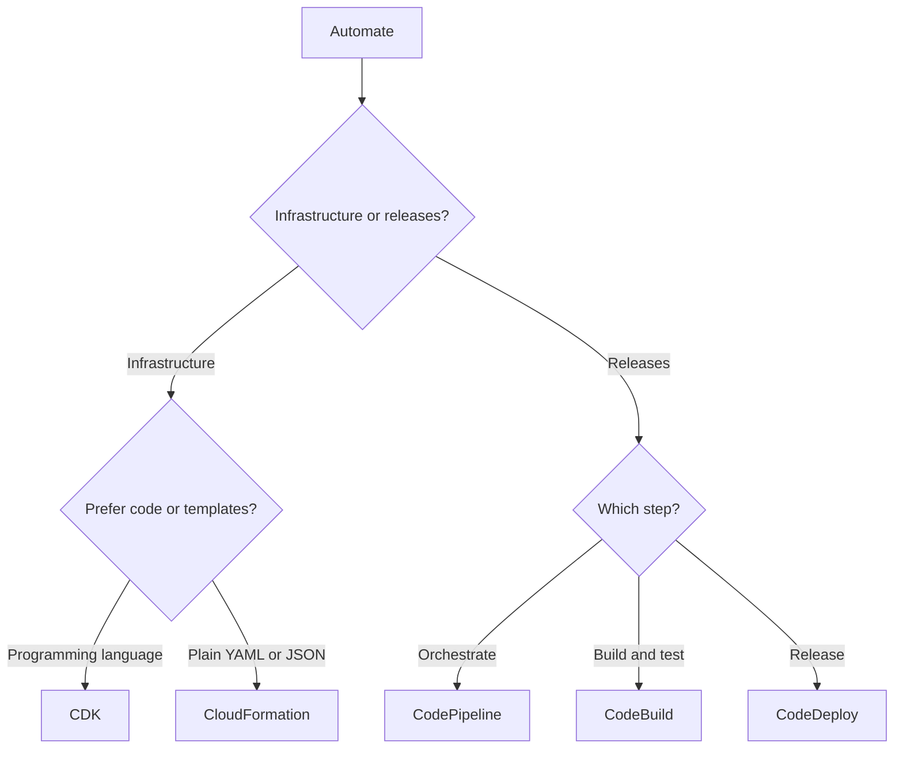

| I need to… | Use | Because | Read |
| --- | --- | --- | --- |
| Repeatable, AWS-native templates with rollback | CloudFormation | Declarative; failed stacks roll back | [chapter 40](/chapters/40-aws-operation-services-iac/) |
| Define infrastructure in a programming language | CDK | Synthesizes to CloudFormation | [chapter 42](/chapters/42-lab-13-infrastructure-as-code-aws-cdk/) |
| Upload code and let AWS run the stack | Elastic Beanstalk | AWS runs EC2, load balancer, scaling | [chapter 40](/chapters/40-aws-operation-services-iac/) |
| Orchestrate source, build, test, deploy | CodePipeline | The conveyor belt | [chapter 43](/chapters/43-aws-devops-services/) |
| Build and test | CodeBuild | Uses buildspec.yml | [chapter 43](/chapters/43-aws-devops-services/) |
| Release to EC2, Lambda or ECS | CodeDeploy | Uses appspec.yml | [chapter 43](/chapters/43-aws-devops-services/) |
| Private package registry | CodeArtifact | Holds packages | [chapter 43](/chapters/43-aws-devops-services/) |
| Deploy to ECS from a pipeline | ECS rolling update or blue/green | Two lab paths; each action expects a different file | [chapter 47](/chapters/47-lab-14-ci-cd-part-3-amazon-ecs-blue-green-deployme/) |

## Disaster recovery strategies

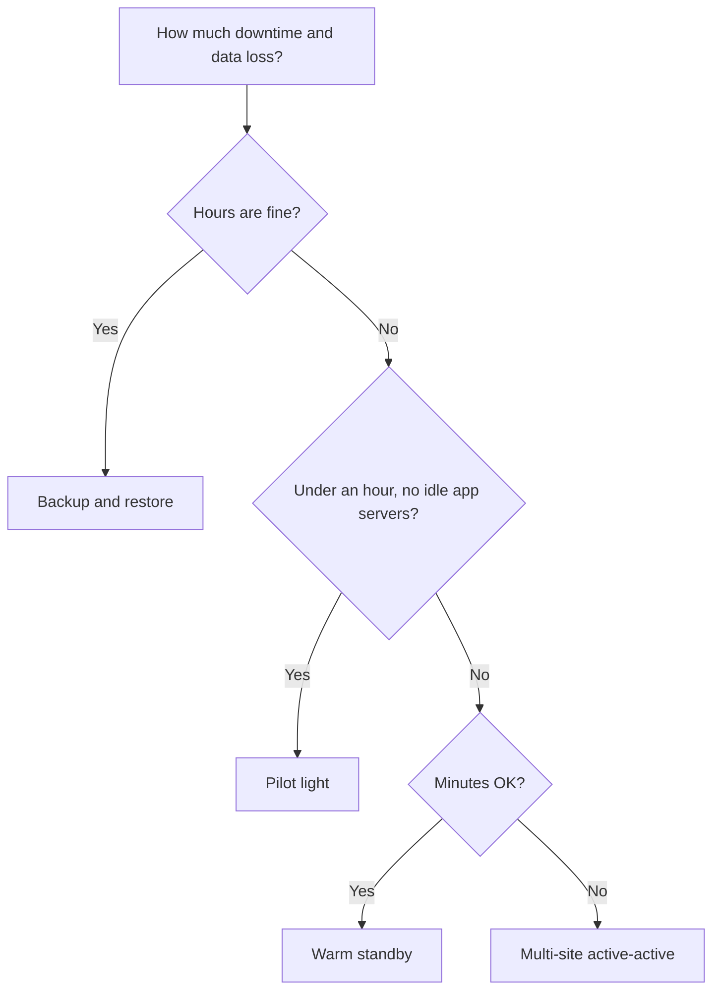

| I need to… | Use | Because | Read |
| --- | --- | --- | --- |
| Accept hours of downtime, cheapest | Backup and restore | Backups only; RTO up to about 24 hours | [chapter 55](/chapters/55-lab-17-build-dr-site-on-aws-backup-and-restore-str/) |
| Recover in tens of minutes | Pilot light | Data layer on, servers off | [chapter 56](/chapters/56-lab-17-build-dr-site-on-aws-pilot-light/) |
| Recover in minutes, test on live capacity | Warm standby | Small full stack always running | [chapter 57](/chapters/57-lab-17-build-dr-site-on-aws-warm-standby-strategy/) |
| Near-zero downtime and data loss | Multi-site active-active | Full stack live in two sites | [chapter 58](/chapters/58-lab-17-build-dr-site-on-aws-multi-site-active-acti/) |
| Seconds of RPO for a database | Aurora Global Database | Cross-Region DR for Aurora | [chapter 21](/chapters/21-aws-database-services-amazon-aurora/) |
| Scheduled backups with cross-Region copies | AWS Backup | Scheduled, cross-Region copies | [chapter 53](/chapters/53-aws-disaster-recovery/) |
| Replicate servers continuously, with drills | Elastic Disaster Recovery | Continuous replication, drills, failback | [chapter 53](/chapters/53-aws-disaster-recovery/) |
| Switch traffic to the standby | Route 53 failover | Health check plus primary and secondary records | [chapter 53](/chapters/53-aws-disaster-recovery/) |

## Multi-account

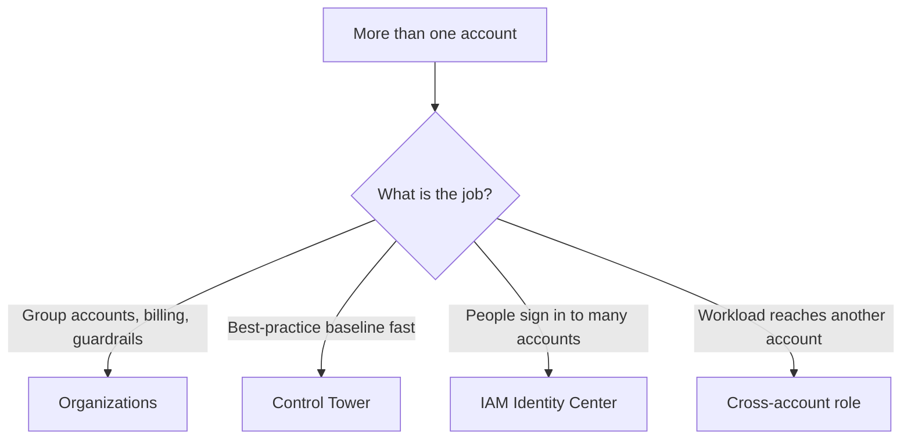

| I need to… | Use | Because | Read |
| --- | --- | --- | --- |
| Accounts, OUs, consolidated billing | Organizations | Base for any multi-account setup | [chapter 52](/chapters/52-multi-account-strategy/) |
| A governed landing zone quickly | Control Tower | Opinionated baseline with Account Factory | [chapter 52](/chapters/52-multi-account-strategy/) |
| People access across accounts without IAM users | IAM Identity Center | Permission sets per user and group | [chapter 52](/chapters/52-multi-account-strategy/) |
| Cap what an account may do | SCP | Maximum only, never grants | [chapter 52](/chapters/52-multi-account-strategy/) |
| Grant what an identity may do | IAM policy | SCP and IAM must both allow | [chapter 04](/chapters/04-aws-identity-and-access-management-iam/) |
| Access a resource in another account | Role plus trust policy | AssumeRole; both sides must allow | [chapter 04](/chapters/04-aws-identity-and-access-management-iam/) |
| Limit blast radius | Separate accounts | Account is the isolation boundary | [chapter 52](/chapters/52-multi-account-strategy/) |

## Common traps

- **Multi-AZ vs read replica**: Multi-AZ is a standby for failover and serves no reads; a read replica scales reads and needs a manual promote. [chapter 20](/chapters/20-aws-database-services-amazon-rds/)
- **RDS vs Aurora**: Aurora is MySQL/PostgreSQL only; Oracle, SQL Server, MariaDB and Db2 need RDS. [chapter 21](/chapters/21-aws-database-services-amazon-aurora/)
- **Aurora replica vs RDS read replica**: Aurora replicas share storage and are failover targets; RDS replicas keep their own copy. [chapter 21](/chapters/21-aws-database-services-amazon-aurora/)
- **Gateway vs interface endpoint**: Gateway is free and only S3 and DynamoDB from inside the VPC; interface works from on premises. [chapter 29](/chapters/29-aws-networking-services-vpc-endpoints/)
- **Endpoint vs NAT gateway**: endpoints reach one AWS service; NAT reaches the internet and costs per hour and per GB. [chapter 29](/chapters/29-aws-networking-services-vpc-endpoints/)
- **Peering vs Transit Gateway vs PrivateLink**: peering is not transitive; Transit Gateway is a hub; PrivateLink exposes one service and tolerates overlapping CIDRs. [chapter 31](/chapters/31-aws-networking-services-aws-transit-gateway/)
- **VPN vs Direct Connect**: VPN is encrypted over the internet; Direct Connect is private but not encrypted by default. [chapter 32](/chapters/32-aws-networking-services-hybrid-connections/)
- **CloudFront vs Global Accelerator**: CloudFront caches HTTP; Global Accelerator gives static IPs for TCP/UDP with no cache. [chapter 48](/chapters/48-aws-edge-services/)
- **WAF vs Shield**: WAF filters HTTP at layer 7; Shield covers layers 3 and 4. [chapter 39](/chapters/39-aws-security-services/)
- **Secrets Manager vs Parameter Store**: only Secrets Manager has built-in rotation. [chapter 39](/chapters/39-aws-security-services/)
- **CloudWatch vs CloudTrail vs Config**: performance, who called the API, and configuration history. [chapter 28](/chapters/28-aws-monitoring-amazon-cloudwatch-and-aws-cloudtrai/)
- **SQS vs SNS vs EventBridge**: pull a queue, push to many, or route by event content. [chapter 37](/chapters/37-aws-serverless-services-messaging-services/)
