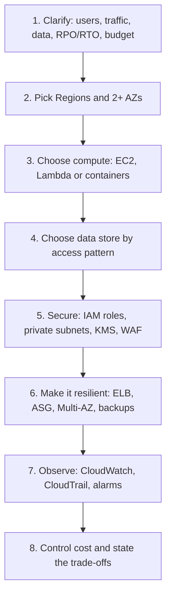

Short model answers for junior and mid cloud engineer interviews. Every answer comes from the chapters; follow the "Read" link when you want the detail. For prices and quotas, say "I would check the current page", as the chapters do.

## How to answer a design question

*Say the steps out loud. Interviewers score your reasoning more than the final diagram.*

## Fundamentals & IAM

### Q: What is the difference between a Region, an Availability Zone and an edge location?
- Region = geographic area where you choose to deploy. AZ = isolated data centers inside a Region, used for fault isolation. Edge location = content caching near users, you deploy no servers there.
- Use multiple AZs for high availability. Use another Region for data residency, user proximity or disaster recovery.
- Choose a Region by: compliance, services available, latency, cost.

Read: [chapter 02](/chapters/02-architecting-foundations/)

### Q: What do you do in the first minutes of a new AWS account?
- Turn on root MFA, create no root access keys, set a billing contact and a budget.
- Create an admin user (or use IAM Identity Center in a company) and stop using root.
- Keep a learning account separate from company accounts; budgets lag a few hours, so delete resources instead of trusting alerts.

Read: [chapter 03](/chapters/03-create-and-setup-your-aws-account/)

### Q: IAM user vs role vs group?
- User: long-term credentials, one person or legacy app. Role: temporary STS credentials, for EC2, Lambda, cross-account and SSO.
- Group: only holds users, has no credentials and is not a principal.
- Use a role for anything running on AWS; a user only when long-term keys are unavoidable.

Read: [chapter 04](/chapters/04-aws-identity-and-access-management-iam/)

### Q: Identity-based vs resource-based policy, and how is access decided?
- Identity-based attaches to a user, group or role and has no `Principal`. Resource-based attaches to a bucket, queue, key or role trust policy and requires `Principal`.
- Evaluation: explicit Deny beats Allow, and no Allow means implicit deny. SCPs, boundaries and session policies only cap, they never grant.
- Cross-account needs an Allow on both sides.

Read: [chapter 04](/chapters/04-aws-identity-and-access-management-iam/)

### Q: A user gets AccessDenied. What do you check?
- Read the message: caller, action, resource, explicit or implicit deny.
- Run `aws sts get-caller-identity`; many bugs are the wrong profile.
- Then look for explicit denies, a permissions boundary or SCP, and the resource policy. Cross-account: check the SCP, the role's trust policy and the caller's AssumeRole permission.

Read: [chapter 04](/chapters/04-aws-identity-and-access-management-iam/), [chapter 52](/chapters/52-multi-account-strategy/)

## Networking

### Q: What makes a subnet public?
- A route table entry `0.0.0.0/0 -> internet gateway`. A private subnet has no IGW route.
- A VPC lives in a Region; a subnet lives in one AZ. AWS reserves 5 IPs per subnet.

Read: [chapter 05](/chapters/05-networking-basic/)

### Q: Security group vs network ACL?
- SG: stateful, allow-only, attached to the ENI. NACL: stateless, allow and deny, numbered rules, attached to the subnet.
- Because a NACL is stateless, it needs ephemeral ports 1024-65535 for replies.

Read: [chapter 05](/chapters/05-networking-basic/)

### Q: Internet gateway vs NAT gateway?
- IGW: two-way internet for public resources, free. NAT gateway: outbound-only for private instances, sits in a public subnet, billed per hour plus per GB.
- Use NAT for patches and third-party APIs. Use endpoints for AWS service traffic.

Read: [chapter 05](/chapters/05-networking-basic/), [chapter 29](/chapters/29-aws-networking-services-vpc-endpoints/)

### Q: An instance in a VPC cannot connect. What is your order of checks?
- Route table, then security group, then NACL (ephemeral ports), then the OS firewall, then VPC Flow Logs.
- A deleted target shows as a blackhole route.

Read: [chapter 05](/chapters/05-networking-basic/)

### Q: Gateway vs interface VPC endpoint?
- Gateway: S3 and DynamoDB only, route-table based, free, VPC-only (not usable from on-premises, peering or Transit Gateway).
- Interface: ENI with a private IP, many services, hourly plus per GB, usable from on-premises.
- First cost fix: add S3 and DynamoDB gateway endpoints so traffic skips the NAT gateway.

Read: [chapter 29](/chapters/29-aws-networking-services-vpc-endpoints/)

### Q: VPC peering vs Transit Gateway vs PrivateLink?
- Peering: point-to-point, not transitive, CIDRs must not overlap, no hourly fee. Fits a few VPCs.
- Transit Gateway: hub-and-spoke, transitive, shares VPN/Direct Connect, many VPCs.
- PrivateLink: exposes one service one-way, overlapping CIDRs allowed.
- Troubleshooting peering: status `active`, routes on both sides, SG, NACL, DNS.

Read: [chapter 30](/chapters/30-aws-networking-services-vpc-peering/), [chapter 31](/chapters/31-aws-networking-services-aws-transit-gateway/), [chapter 33](/chapters/33-aws-networking-services-aws-privatelink/)

### Q: Site-to-Site VPN vs Direct Connect?
- VPN: encrypted IPsec over the internet, set up in minutes, two tunnels built in.
- Direct Connect: dedicated private circuit, consistent performance, slower to set up, not encrypted by default (use MACsec or a VPN on top).
- Common pattern: Direct Connect primary, VPN backup.

Read: [chapter 32](/chapters/32-aws-networking-services-hybrid-connections/)

## Compute & scaling

### Q: EC2 vs Lambda vs Fargate vs EKS?
- EC2: full control, you manage OS and scaling. Lambda: code only, pay per request and GB-second, up to 15 minutes. Fargate: containers without servers, long-running. EKS: only when the team needs Kubernetes.
- ECS is simpler and AWS-native; EKS gives the Kubernetes ecosystem with more concepts.

Read: [chapter 08](/chapters/08-aws-computes-aws-lambda-and-containers/)

### Q: How do you reach a private EC2 instance without a bastion?
- Session Manager: no inbound port, no key pair, needs the instance profile, SSM Agent and outbound 443 or VPC endpoints.
- Cannot SSH? Check security group, route to the IGW, key pair and status checks. Instance missing from Session Manager? Check the instance profile, endpoints or NAT route, and that the agent runs.

Read: [chapter 06](/chapters/06-aws-compute-services-amazon-ec2/)

### Q: ELB vs Auto Scaling group, and which scaling policy do you pick?
- ELB spreads traffic and stops sending to bad targets. ASG controls how many instances exist and replaces bad ones. Use both.
- Default is target tracking. Scheduled for known peaks. Predictive for recurring cycles, plus a dynamic policy.
- Use min at least 2, health check type ELB with a realistic grace period, and keep instances stateless.

Read: [chapter 26](/chapters/26-aws-auto-scaling/)

### Q: ALB vs NLB vs GWLB?
- ALB: HTTP layer 7. NLB: TCP/UDP layer 4, fixed IPs. GWLB: layer 3 with GENEVE, for firewalls.

Read: [chapter 26](/chapters/26-aws-auto-scaling/)

### Q: A Lambda function is slow or throttled. How do you troubleshoot?
- Read the REPORT line. Max Memory Used near the setting: raise memory. Duration near the timeout: raise it or split the work. Large Init Duration: slim the package or use provisioned concurrency.
- `TooManyRequestsException` means concurrency ran out; check reserved concurrency and the Regional quota.
- Reserved concurrency is free (guarantee and cap); provisioned is pre-warmed and billed.

Read: [chapter 08](/chapters/08-aws-computes-aws-lambda-and-containers/)

## Storage

### Q: Block vs file vs object storage on AWS?
- EBS: block disk for one instance, one AZ. EFS: shared NFS for Linux, Region-wide. FSx: managed Windows (SMB), Lustre, ONTAP or OpenZFS. S3: objects over HTTP, unlimited.
- Windows shares need FSx for Windows, not EFS.

Read: [chapter 10](/chapters/10-aws-storage-services-aws-ebs/), [chapter 12](/chapters/12-aws-storage-services-amazon-efs-and-fsx/)

### Q: EBS vs instance store, and which EBS volume type by default?
- EBS survives stop and supports snapshots and resizing. Instance store is lost on stop and terminate, kept on reboot; use it for cache or scratch.
- Default: gp3, encrypted, with a snapshot policy. io2 for top IOPS, latency, durability and Multi-Attach. st1/sc1 are HDD and never boot volumes.
- Cannot attach a volume? Check the AZ first, then the state is `available`.

Read: [chapter 10](/chapters/10-aws-storage-services-aws-ebs/)

### Q: Explain S3 storage classes and how you cut cost.
- Standard for hot data, Intelligent-Tiering for unknown patterns, Standard-IA and One Zone-IA for infrequent, Glacier Instant, Flexible and Deep Archive for archives. Colder means cheaper storage, retrieval fees and minimum durations (30/90/180 days).
- Use lifecycle rules, expire old versions, abort incomplete multipart uploads, and use a gateway endpoint instead of NAT for S3 traffic.

Read: [chapter 14](/chapters/14-aws-storage-services-amazon-s3/)

### Q: You get Access Denied on S3. What do you check?
- In order: explicit Deny (bucket policy, SCP), Block Public Access, the IAM policy, the KMS key policy, and whether another account owns the object.
- Baseline for a new bucket: Block Public Access on, ACLs disabled, encryption, versioning for important data.

Read: [chapter 14](/chapters/14-aws-storage-services-amazon-s3/), [chapter 39](/chapters/39-aws-security-services/)

## Databases

### Q: How do you choose a database service?
- Start from the access pattern. Joins and ACID: RDS or Aurora. Key access at huge scale: DynamoDB. JSON documents: DocumentDB. Cache: ElastiCache. Graph: Neptune. Time series: Timestream. Analytics: Redshift.
- Do not run reports on the production OLTP database.

Read: [chapter 19](/chapters/19-aws-database-services-intro/)

### Q: Multi-AZ vs read replica in RDS?
- Multi-AZ: high availability, synchronous, automatic failover, standby serves no reads. Read replica: scale reads or DR, asynchronous, manual promote, own endpoint, can be cross-Region.
- They combine: a Multi-AZ source can have read replicas.
- After failover the app must reconnect through the DNS name, never an IP.

Read: [chapter 20](/chapters/20-aws-database-services-amazon-rds/)

### Q: RDS vs Aurora?
- Aurora: shared cluster volume with six copies across 3 AZs, up to 15 replicas, failover typically about 30 s, MySQL/PostgreSQL-compatible only.
- RDS: EBS per instance, more engines (Oracle, SQL Server, MariaDB, Db2), lower floor cost for small workloads.
- Apps write to the cluster endpoint and read from the reader endpoint.

Read: [chapter 21](/chapters/21-aws-database-services-amazon-aurora/), [chapter 20](/chapters/20-aws-database-services-amazon-rds/)

### Q: DynamoDB on-demand vs provisioned, and GSI vs LSI?
- On-demand for unknown or spiky traffic; provisioned (plus reserved capacity) for steady, forecastable traffic.
- GSI: any time, different keys, eventual reads only. LSI: only at table creation, same partition key, strong reads, 10 GB per partition key value.
- `ProvisionedThroughputExceededException` is throttling: raise capacity, spread keys or use on-demand. Avoid Scan.

Read: [chapter 23](/chapters/23-aws-database-services-amazon-dynamodb/)

### Q: How does caching work, and Valkey/Redis vs Memcached?
- Lazy loading: read, miss, load DB, fill cache. Write-through: write both together. Use both plus a TTL.
- Valkey/Redis: failover, persistence, rich data types. Memcached: simplest object cache, scale out by adding nodes.

Read: [chapter 24](/chapters/24-aws-database-caching-and-migration/)

### Q: How do you migrate a database to AWS?
- DMS moves data and replicates changes (CDC) while the source stays online.
- Same engine: DMS plus native tools. Different engine: convert the schema first with SCT or DMS Schema Conversion, then DMS.
- Validate, then cut over.

Read: [chapter 24](/chapters/24-aws-database-caching-and-migration/)

## Serverless & messaging

### Q: API Gateway REST vs HTTP API, and function URL vs API Gateway?
- HTTP API: cheaper, built-in JWT and CORS. REST API: keys, usage plans, request validation, WAF, stage caching.
- Function URL: quick single-function endpoint. API Gateway: production API with many routes and controls.
- Start with HTTP API.

Read: [chapter 35](/chapters/35-aws-serverless-services-lambda-and-dynamodb-and-ap/)

### Q: API Gateway returns 403, 429, 502 or a CORS error. What does each mean?
- 403: authorizer or missing permission. 429: throttled. 502: bad Lambda response format. CORS error: missing headers.
- Use the Lambda proxy integration so the event carries the whole request.

Read: [chapter 35](/chapters/35-aws-serverless-services-lambda-and-dynamodb-and-ap/)

### Q: SQS vs SNS vs EventBridge?
- SQS: queue, consumer pulls, stores up to 14 days. SNS: pub/sub push to all subscribers. EventBridge: bus and rules, routes by event content, native AWS events and schedules.
- SNS fan-out to SQS queues is the common combination.

Read: [chapter 37](/chapters/37-aws-serverless-services-messaging-services/)

### Q: SQS Standard vs FIFO, and what do you do about failed messages?
- Standard: at-least-once, best-effort order. FIFO: ordered per message group, exactly-once processing, name ends `.fifo`.
- Make consumers idempotent. Attach a DLQ (redrive policy with `maxReceiveCount`) and alarm on its depth. Use long polling (20 s).
- SNS subscription not receiving? Check confirmation, the SQS queue policy and the filter policy.

Read: [chapter 37](/chapters/37-aws-serverless-services-messaging-services/)

## Security

### Q: How do you encrypt data on AWS?
- At rest: KMS. In transit: TLS with certificates from ACM.
- Key types: AWS owned, AWS managed (auto-rotate yearly, same account only), customer managed (when you must share the key or control its policy).
- Encrypt/Decrypt directly handles up to 4 KB; for big data use `GenerateDataKey`.

Read: [chapter 39](/chapters/39-aws-security-services/)

### Q: WAF vs Shield?
- WAF filters HTTP requests at layer 7 (SQL injection, XSS, bots), attaches to CloudFront, ALB, API Gateway and more.
- Shield Standard is free and always on for layers 3/4. Shield Advanced is a paid subscription with expert help.
- Roll out new WAF rules in Count mode before Block.

Read: [chapter 39](/chapters/39-aws-security-services/)

### Q: GuardDuty vs Inspector vs Macie?
- GuardDuty: is someone attacking me (account activity and logs). Inspector: is my software vulnerable (compute workloads). Macie: where is my sensitive data (S3).
- Security Hub collects findings in one place.

Read: [chapter 39](/chapters/39-aws-security-services/)

### Q: Secrets Manager vs Parameter Store, and what are the secrets rules?
- Secrets Manager: built-in Lambda-driven rotation, cross-Region replication, for DB passwords and API keys. Parameter Store: general config, no built-in rotation.
- Never commit keys to Git. If a key leaks, deactivate it, check CloudTrail, delete it. An encrypted resource denying access is often a missing `kms:Decrypt` or key policy.

Read: [chapter 39](/chapters/39-aws-security-services/), [chapter 04](/chapters/04-aws-identity-and-access-management-iam/)

### Q: What is an SCP, and how does it differ from an IAM policy?
- SCP attaches to the root, an OU or an account and sets the maximum allowed; it never grants and does not restrict the management account. IAM policy says what an identity may do.
- Effective access needs both to allow. Attach SCPs to OUs and test on a sandbox OU first.

Read: [chapter 52](/chapters/52-multi-account-strategy/)

## Observability

### Q: CloudWatch vs CloudTrail vs Config?
- CloudWatch: how is it performing (metrics, logs, alarms). CloudTrail: who made which API call. Config: resource configuration history and compliance.
- Investigation order: alarm, Logs Insights, then CloudTrail for who changed it.

Read: [chapter 28](/chapters/28-aws-monitoring-amazon-cloudwatch-and-aws-cloudtrai/)

### Q: There is no memory graph for an EC2 instance, or an alarm stays INSUFFICIENT_DATA. Why?
- No memory or disk-used metric without the CloudWatch agent (`CWAgent`).
- INSUFFICIENT_DATA: check the metric name, dimensions and that data arrives.
- EC2 basic metrics are every 5 minutes (free); detailed is 1 minute (paid).

Read: [chapter 28](/chapters/28-aws-monitoring-amazon-cloudwatch-and-aws-cloudtrai/)

### Q: How do you keep CloudWatch and CloudTrail useful and cheap?
- Set log retention on every log group (default is forever). Point alarms at an SNS topic someone reads.
- CloudTrail event history lasts 90 days, so create a trail to S3 for long-term; enable data events only where needed.

Read: [chapter 28](/chapters/28-aws-monitoring-amazon-cloudwatch-and-aws-cloudtrai/)

## IaC & CI/CD

### Q: CloudFormation vs CDK vs SAM?
- All deploy through CloudFormation stacks. CloudFormation: YAML/JSON templates. CDK: real code that `cdk synth` turns into a template. SAM: short YAML for serverless.
- IaC is declarative, repeatable and rolls back on failure; console clicks are not repeatable.

Read: [chapter 40](/chapters/40-aws-operation-services-iac/), [chapter 38](/chapters/38-lab-12-automation-with-amazon-eventbridge-schedule/)

### Q: A CloudFormation stack failed. What do you do?
- Open the Events tab first; the error is on the failed resource. Failed create or update rolls back automatically.
- Never edit stack resources by hand; the template and reality drift apart. Clean up by deleting the whole stack.

Read: [chapter 40](/chapters/40-aws-operation-services-iac/)

### Q: What does each AWS CI/CD service do?
- CodePipeline orchestrates; CodeBuild builds and tests (`buildspec.yml`); CodeDeploy releases (`appspec.yml`) to EC2/on-premises, Lambda or ECS.
- CodeArtifact holds packages, ECR holds images, CodeConnections links third-party Git.

Read: [chapter 43](/chapters/43-aws-devops-services/)

## Edge & DNS

### Q: Name some Route 53 routing policies and when to use them.
- Latency for speed, geolocation for rules about user location, weighted for canary/gradual rollout, failover for active-passive DR, plus simple, geoproximity, IP-based and multivalue.
- Alias records point to AWS resources and work at the apex; use alias, not CNAME, for `example.com`.

Read: [chapter 48](/chapters/48-aws-edge-services/)

### Q: CloudFront vs Global Accelerator?
- CloudFront: caches and delivers HTTP/HTTPS, edge code, signed URLs. Global Accelerator: TCP/UDP over the AWS backbone, two static anycast IPs, no cache, fast failover without waiting for DNS TTLs.

Read: [chapter 48](/chapters/48-aws-edge-services/)

### Q: How do you serve a private S3 bucket as a website, and fix stale cache after deploy?
- Put CloudFront in front with OAC and keep Block Public Access on. S3 static hosting alone is HTTP only.
- Use versioned file names; invalidate only when you must.
- Route 53 failover not working? Check the health check status, that it is attached to the record, and the TTL.

Read: [chapter 48](/chapters/48-aws-edge-services/), [chapter 14](/chapters/14-aws-storage-services-amazon-s3/)

## Resilience & DR

### Q: RPO vs RTO, and HA vs DR?
- RPO = data you can lose. RTO = time you can be down.
- HA survives small failures (Multi-AZ). DR survives a Region-sized loss.
- Ask for RPO and RTO per workload first, then choose a strategy.

Read: [chapter 53](/chapters/53-aws-disaster-recovery/)

### Q: Name the four DR strategies.
- Backup and restore (hours of RPO, up to about 24 hours RTO), pilot light (data on, servers off), warm standby (small full copy running), multi-site active-active (near zero).
- Cheap to costly in that order.

Read: [chapter 53](/chapters/53-aws-disaster-recovery/)

### Q: Which AWS features help DR?
- AWS Backup with cross-Region copies, S3 cross-Region replication, Aurora Global Database (seconds RPO, minutes RTO), DynamoDB global tables, Elastic Disaster Recovery, Route 53 failover.
- Replication copies mistakes too, so keep point-in-time backups or versioning. Drill regularly.

Read: [chapter 53](/chapters/53-aws-disaster-recovery/)

## Cost

### Q: What are common AWS cost traps?
- Idle EC2/RDS, NAT gateways, unattached EBS volumes and Elastic IPs, old snapshots, data transfer out, cross-AZ traffic, forgotten cache clusters and health checks.
- Use budgets, Cost Explorer and tags such as `env=lab`.

Read: [chapter 03](/chapters/03-create-and-setup-your-aws-account/), [chapter 05](/chapters/05-networking-basic/)

### Q: How do you cut a high data transfer or NAT bill?
- Data in is free; out to the internet, cross-AZ and cross-Region cost money. Same-AZ private IP is free.
- Add S3 and DynamoDB gateway endpoints, put CloudFront in front of public content, keep chatty tiers in one AZ. Read the bill by usage type (`DataTransfer-Regional-Bytes` is cross-AZ).

Read: [chapter 34](/chapters/34-aws-data-transfer/), [chapter 29](/chapters/29-aws-networking-services-vpc-endpoints/)

### Q: What EC2 and database purchase options exist?
- EC2: On-Demand, Savings Plans, Reserved, Spot (2-minute warning). Dedicated Host for licence and compliance.
- Databases: reserved instances and Database Savings Plans (check current terms). DynamoDB provisioned plus reserved capacity for steady load.
- Right-size with Compute Optimizer; always check current prices.

Read: [chapter 06](/chapters/06-aws-compute-services-amazon-ec2/), [chapter 24](/chapters/24-aws-database-caching-and-migration/), [chapter 08](/chapters/08-aws-computes-aws-lambda-and-containers/)

## Design scenarios

### Q: Design a highly available three-tier web app.
- Route 53 alias to an ALB across 2+ AZs, an ASG of stateless EC2 (min 2) in private subnets, sessions in ElastiCache, RDS Multi-AZ or Aurora with a reader in another AZ in private subnets, SG-to-SG rules, HTTPS via ACM, alarms on CloudWatch.

Read: [chapter 26](/chapters/26-aws-auto-scaling/), [chapter 20](/chapters/20-aws-database-services-amazon-rds/), [chapter 59](/chapters/59-capstone-project/)

### Q: Design a serverless to-do API.
- HTTP API (JWT authorizer) to Lambda with a scoped execution role, DynamoDB on-demand, WAF if REST API, CloudWatch logs with retention set.

Read: [chapter 35](/chapters/35-aws-serverless-services-lambda-and-dynamodb-and-ap/), [chapter 23](/chapters/23-aws-database-services-amazon-dynamodb/)

### Q: Design an image upload and processing pipeline.
- Presigned URL upload to S3, S3 event to SQS (buffer, DLQ with alarm) or Lambda, converted images back to S3, lifecycle rules for old data.

Read: [chapter 14](/chapters/14-aws-storage-services-amazon-s3/), [chapter 37](/chapters/37-aws-serverless-services-messaging-services/)

### Q: Design a global static website.
- Private S3 bucket, CloudFront with OAC, ACM certificate, Route 53 alias record, versioned file names, optional WAF.

Read: [chapter 48](/chapters/48-aws-edge-services/), [chapter 14](/chapters/14-aws-storage-services-amazon-s3/), [chapter 39](/chapters/39-aws-security-services/)

### Q: Connect 20 VPCs and an office securely.
- Transit Gateway as the hub shared by RAM, Site-to-Site VPN (or Direct Connect with VPN backup) attached once, TGW route tables for segmentation, non-overlapping CIDRs planned first, endpoints for AWS service traffic.

Read: [chapter 31](/chapters/31-aws-networking-services-aws-transit-gateway/), [chapter 32](/chapters/32-aws-networking-services-hybrid-connections/), [chapter 29](/chapters/29-aws-networking-services-vpc-endpoints/)

### Q: Design DR for a web app with RPO of minutes and RTO under an hour.
- Pilot light or warm standby in a second Region: cross-Region replicated data (Aurora Global Database or cross-Region backups), IaC for the stack, Route 53 failover with health checks and low TTL, regular drills.

Read: [chapter 53](/chapters/53-aws-disaster-recovery/), [chapter 21](/chapters/21-aws-database-services-amazon-aurora/), [chapter 48](/chapters/48-aws-edge-services/)

### Q: Design a multi-account setup for a growing company.
- Organizations with OUs, Control Tower landing zone, separate prod and dev accounts, a log archive account, SCPs on OUs, IAM Identity Center for people, roles for cross-account access.

Read: [chapter 52](/chapters/52-multi-account-strategy/), [chapter 04](/chapters/04-aws-identity-and-access-management-iam/)

### Q: Decouple an order system so traffic spikes do not break it.
- API to SNS topic, fan-out to SQS queues, workers (ASG or Lambda) scaling on queue depth, DLQ with alarm, idempotent consumers, FIFO only if order matters.

Read: [chapter 37](/chapters/37-aws-serverless-services-messaging-services/), [chapter 26](/chapters/26-aws-auto-scaling/)
